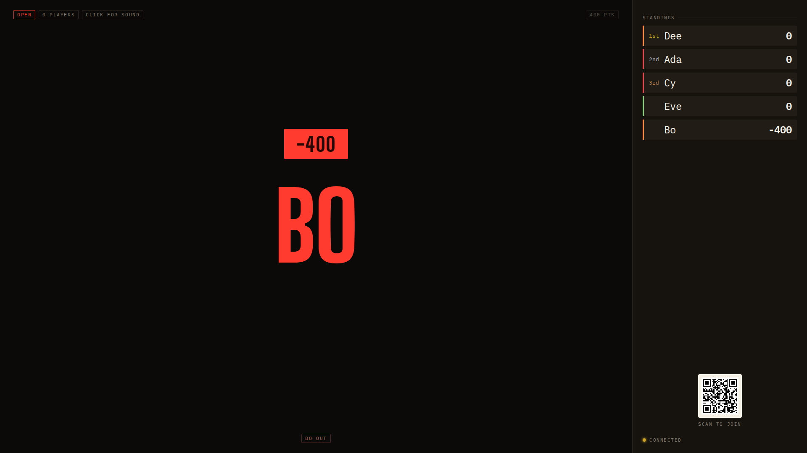
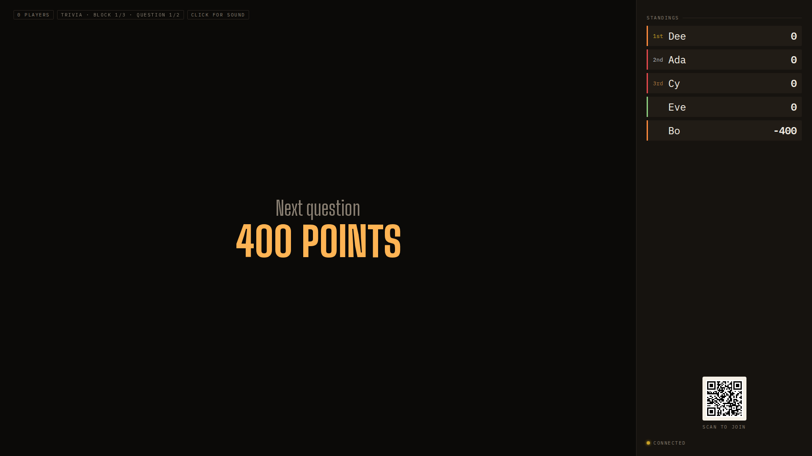

## Opportunity
Every status chip on the board renders at `--t-xs` (11px) with 0.6 opacity on
the stakes. At 1920×1080 that is the smallest type on a screen meant to be
"read across a room" (`docs/design.md` §3: "Board type is viewport-relative
because it is read across a room. Host and phone type is fixed because it is
read at arm's length. Don't mix the two."). The chips are fixed-rem host type
on the board.

In the rebound frame the room-relevant facts are all chips: `OPEN`, `400 PTS`
(top right, dimmed) and `BO OUT` (bottom centre). The hero and stamp are
280px tall; the facts that explain them are 11px.

The setlist chip (`TRIVIA · BLOCK 1/3 · QUESTION 1/2`) is the same 11px as
`0 PLAYERS` beside it, while the design guide §5 says "This chip is larger
and more legible than the other status chips." Doc and CSS disagree, which the
guide itself calls a bug. `client/Board.tsx:566` gives it plain `chip`.

## Proposal
Add a board chip tier in `client/tokens.css` and `client/style.css`:
`--t-chip-board: clamp(0.95rem, 1.25vw, 1.6rem)` applied to `.board__status
.chip`, `.board__stakes` and `.board__barred .chip`, keeping the chip's
uppercase tracking and `--dim` colour. Drop `.board__stakes` to 0.8 opacity.
Give the setlist chip its promised step up: `--t-chip-board` × 1.2 and
`--chalk` text. Host and phone chips stay exactly as they are.
In: board chip sizes and the setlist chip's weight. Out: new chip content,
moving any chip, the lamp and QR caption.

Judge: opus, because the sizes are pinned above and the work is matching
three selectors without touching the host and phone chips.

## What you'll see
At 1920×1080 a chip reads at about 24px cap height, the setlist chip near
29px in chalk, both still in the corners and never competing with the hero.
`BO OUT` under a miss is readable from the sofa.

## Verification
`npm run build`, `npm test`. `npm run review` scenario with a setlist block
and a rebound to confirm the chips never wrap into the hero's band at
1280-wide and 1920-wide board windows.

## Risks and the alternative considered
Many lockout chips (five players out) could wrap into a second row; the
`.board__status` row already wraps, and the hero band is centred, so a second
row costs nothing. The alternative, making the chips viewport-relative via
`--t-xl`, was too large: the value chip at 48px fights the stamp.

## Needs from Rick
