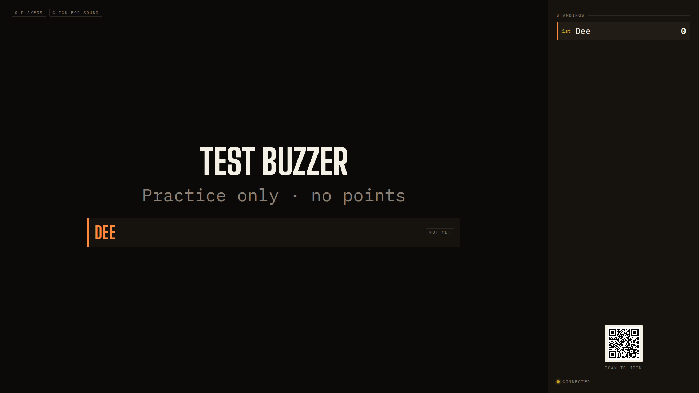
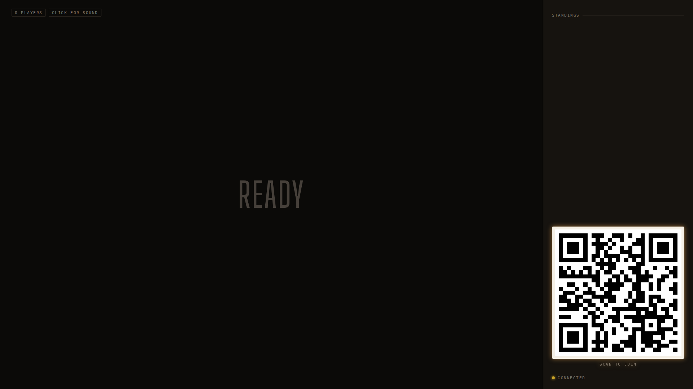

## Opportunity
The join QR is full size only while `state.players.length === 0`
(`client/Board.tsx:753`). The first phone in shrinks it to 6.5rem (104px at
1920×1080) for everyone after, including through the whole lobby, which is the
one moment whose job is arrival.

The lobby board above says `TEST BUZZER` at hero size while the QR the next
nine guests need is 104px in a corner. The manual checklist requires
"Scanning the QR shown on `/board` works from across the room"; a 104px code
does not from more than about two metres.

Nowhere on the board is the address written out. The README's own fallback
("If it will not resolve, `https://192.168.0.84:8097` still plays") is printed
to the terminal only. A guest whose camera app will not scan has nothing to
type.

## Proposal
Rule change in `Board.tsx`: the QR is full size while the room has no players
**or** the arrival moment is the lobby or a first-block introduction; it goes
small when play starts. Under the QR, print the board's own
`location.host` in `--mono` at `--t-lg` under the "Scan to join" caption
(the server opens the board on the join URL precisely so the certificate
name matches, `server/index.ts:431-446`), with a `--dim` second line
"or type the address". Hide the line when `location.hostname` is `localhost`
or a loopback IP.
In: QR sizing rule, address caption. Out: any new server message, a URL in
the protocol, QR on the phone.

Judge: sonnet, because the rule and the caption are fully specified and the
whole change is one component and two CSS lines.

Built as specified, with two review findings folded in: the address carries its scheme and wraps only between scheme, host and port (a bare host typed into a phone goes to http and the server is https-only), and the standings win the sidebar, so a long lobby roster shrinks the code toward its small size instead of being cut off.

## What you'll see
Open lobby: a 370px QR with the address under it; Arm: the QR eases down to
the corner as it does now. The standings column still has room for the roster
beside it.

## Verification
`npm run build`, `npm test`. `npm run review` lobby scenario at 1920×1080 and
1280×720 shows the QR at full size with the caption; a `buzz:open` scenario
shows it small.

## Risks and the alternative considered
A 12-player lobby roster plus a big QR may overflow the sidebar at 1280×720;
the standings list already scrolls, so the QR takes precedence. The
alternative, sending the join URL from the server in `welcome`, is cleaner
but is an `L` change to the protocol for one caption.

## Needs from Rick
