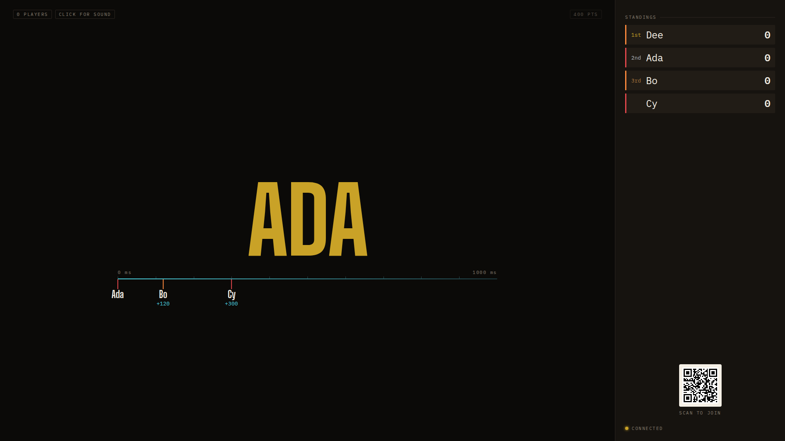
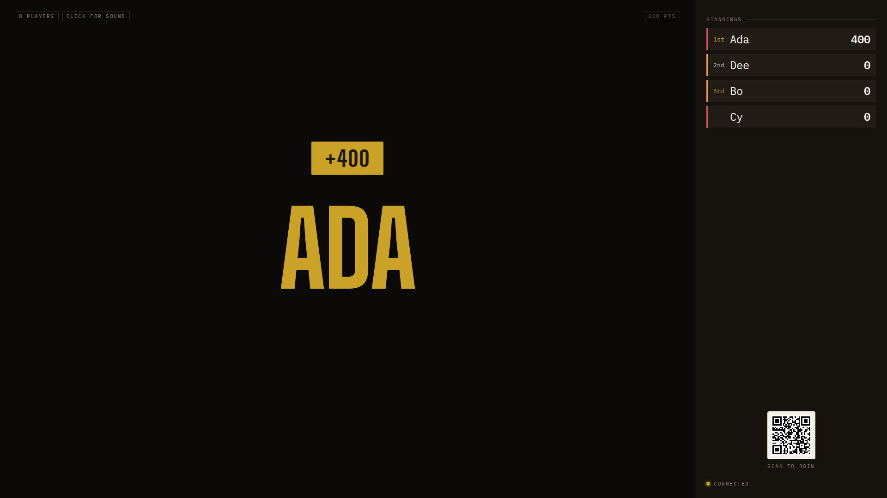

## Opportunity
A name that has just buzzed and a name that has just been awarded are the same
brass on the board; only the `+400` stamp arriving above tells them apart.

`.board__hero` is `color: var(--brass)` for both (`client/style.css:520`),
and `shared/wall.ts:324` gives an award the same `answering` tone as a buzz.
The design guide §2 reserves brass for "First place, correct, awarded,
connected" and gives `--tungsten` to "Armed, charging, the primary action".
The code comment above `.is-penalised` says it itself: "brass is what a payoff
looks like." The room gets the payoff colour before the judge has spoken, so
a host's "no" after a brass name reads as a reversal rather than a verdict.

## Proposal
Three tones, one per state, named in `shared/wall.ts` and coloured only in
`style.css`:

| Tone | When | Colour |
|---|---|---|
| `answering` | leader in the order, judge open | `--tungsten` |
| `awarded` | `verdict:award` | `--brass` (as today) |
| `penalised` | `verdict:penalty` | `--tally` (as today) |

`Wall.hero.tone` gains `awarded`; `scorer` in `wallOf` uses it for a positive
award. `Hero` keeps its `key={name}` so the recolour from tungsten to brass
plays on the same letters, and `fx-hero-slam-glow`'s glow colour follows the
tone through `--fx-color`. The timeline and stamp are untouched.
In: the tone, the three colours, the glow colour. Out: a call word above the
hero, any phone or host change.

Judge: opus, because the colours and states are pinned above and the work is
threading one enum value through `wall.ts`, its tests and two CSS rules.

## What you'll see
A buzz slams in tungsten, the same warm the host's Arm button wears. Correct
turns it brass as the stamp lands; wrong turns it tally and shakes as it does
now. The leader's name in the standings column stays brass, so brass on the
wall is only ever a result.

## Verification
`npm test` (`shared/wall.test.ts` gains the `awarded` tone case for an award
and keeps `answering` for a buzz), `npm run build`, then the `adversarial-qa`
skill on the hero slam, since the glow colour changes.

## Risks and the alternative considered
Tungsten is also the "Standing by" chip colour; on the hero at 280px it is
unmistakably a name, not a chip. The alternative, an "Answering" call word
above the hero, adds a band the three-band layout must hold space for and
says in text what colour can say faster at ten feet.

## Needs from Rick
