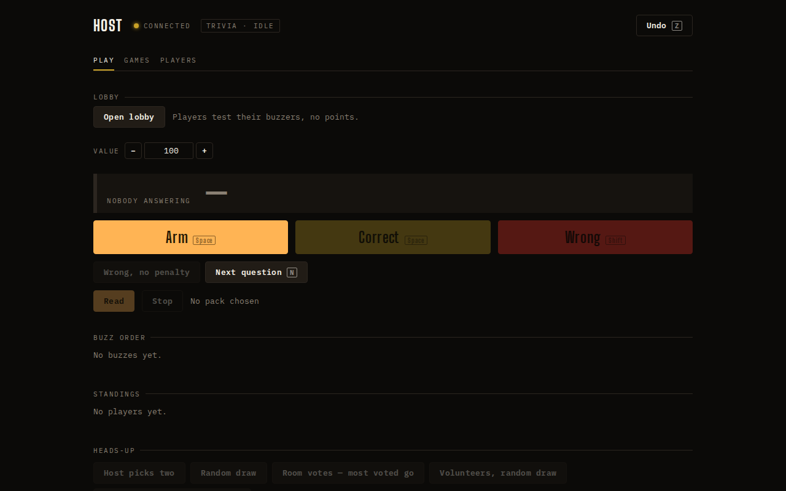
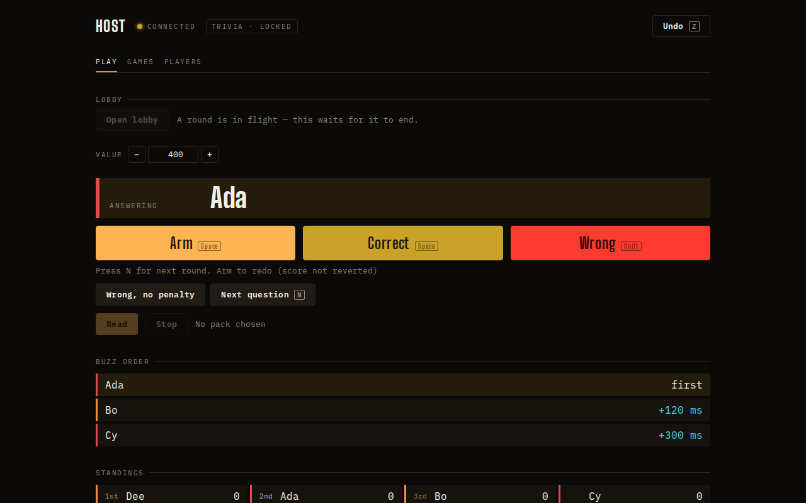

## Opportunity
The note under the three major buttons (`client/Host.tsx:519-520`) mounts
only when there is something to say, so the row with **Wrong, no penalty**
and **Next question** moves every time a moment changes.

Measured at 1280×800: the secondary row sits at y=443 when idle and y=468
once someone is answering, a 25px jump; the Read row moves with it. The host
reaches for Next question several times a minute, with eyes on the room, and
the control they aim at is the one that moves. Principle 1 in `PRODUCT.md`
asks for "the next valid action" to be clear; a target that shifts is the
opposite. The note also appears twice in the same frame ("A round is in
flight — this waits for it to end" beside Open lobby and again under
Heads-up), so the reason is already said elsewhere when it shifts the keys.

## Proposal
Reserve the note's line: a `.host__notes` wrapper with
`min-height: calc(2 * var(--t-sm) * 1.4)` (two lines of `--t-sm`) always
rendered under the majors, the two notes inside it, empty when there is
nothing to say. Nothing else changes.
In: one wrapper and one CSS rule. Out: rewording any note, the Heads-up
section's own reason line.

Judge: sonnet, because the measurement and the rule are given and the change
is a wrapper and a `min-height`.

## What you'll see
Arm, Correct, Wrong, the secondary row and Read sit at the same y for the
whole night; the note fades into a space that was always there.

## Verification
`npm run build`. Re-shoot `/host` at 1280×800 idle and with a leader (the two
frames above) and confirm the secondary row's y is identical.

## Risks and the alternative considered
Two reserved lines push the Buzz order eyebrow 20px further down when idle;
at 1280×800 the standings still start above the fold. The alternative,
placing the notes under the secondary row, keeps the majors still but still
moves Read.

## Needs from Rick
