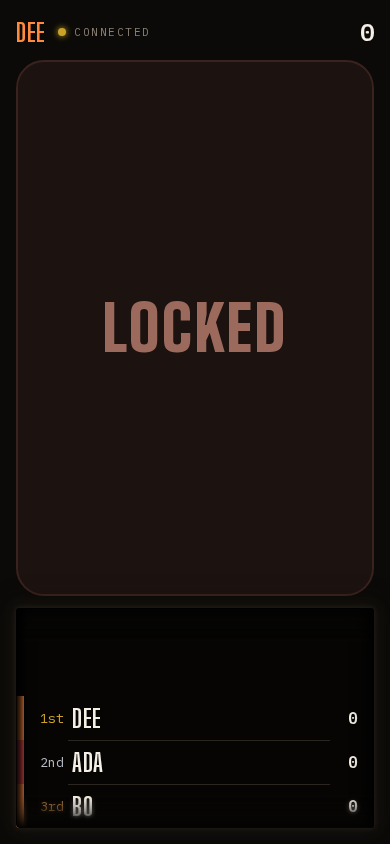
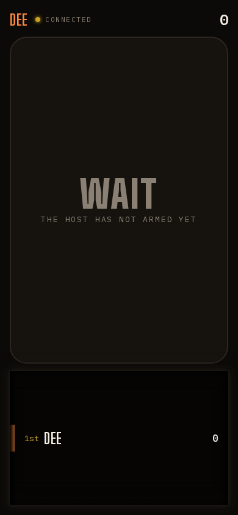

## Opportunity
The standings dial rests at scroll 0, which puts 1st place in the clear band
and two rows of empty well above it (`.dial__list` pads two rows,
`client/style.css:1305`; `StandingsDial` sets no scroll position).

At 390×844 a player who is 9th of 12 sees 1st, 2nd and a frosted 3rd; their
own row needs a scroll every time. The dial is the phone's only answer to
"where am I", and `PRODUCT.md` wants phones "equally clear and engaging for
each player", not a leaderboard for the leader.

The same frame shows the buzzer reading `LOCKED` with no sub-line. The phone
reaches `shared/wall.ts:619` with no `deltaMs` because Dee never pressed, so
`sub` is `''`. Every other mood explains itself ("The host has not armed
yet", "Counting the rest of the field"); this one, the most common state of a
phone during a question, says nothing.

## Proposal
Two small things in the phone's own module:

1. `StandingsDial` scrolls the player's own row into the band on mount and
   after each reorder when the list is not being touched (no `pointerdown`
   in the last second), using the existing `useFlip` slot positions.
   Players in the top three still see 1st at the top edge of the clear band.
2. `phoneOf` gives `Locked` a sub-line when there is no `deltaMs`:
   "Someone else is answering" while a leader holds the question, and
   "Didn't make the order" when the collect window closed without a press.
   No names: phones do not get the order (`viewFor` redaction stays as is).

In: initial and post-change scroll, two strings. Out: changing the dial's
height, tilt or snap; any new field in the phone projection.

Judge: opus, because the scroll rule and the strings are pinned and the only
hard part is not fighting the user's own flick.

## What you'll see
Dee opens her phone and sees `8th Hal · 9th DEE · 10th Ida`, her row centred
and lit; a score change slides the list so she stays in the band. While Ada
answers, the buzzer reads `LOCKED / SOMEONE ELSE IS ANSWERING`.

## Verification
`npm test` (`shared/wall.test.ts` gains the two `Locked` sub cases).
`npm run review` phone scenario with twelve players confirms the own row is
in the band at 390×844 and 360×740.

## Risks and the alternative considered
Scrolling under a thumb is the real risk; the one-second touch guard and
`scroll-snap-type: y proximity` keep the user's flick in charge. The
alternative, pinning your own row outside the dial as a fixed line, adds a
row of chrome between the buzzer and the dial on a short phone.

## Needs from Rick
