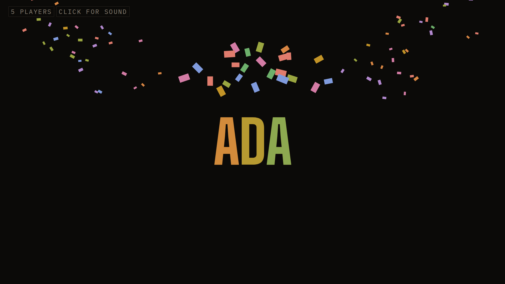
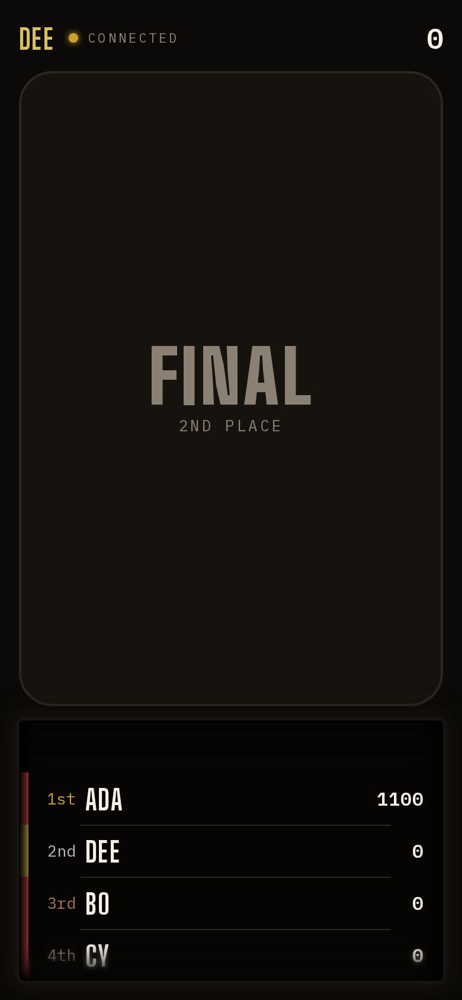

## Opportunity
When a setlist runs out (`idle:finale`, `shared/wall.ts:176`) the board drops
the standings sidebar, fires confetti and shows one name in a rainbow
gradient. That is the whole ceremony.

Measured at 1920×1080: the wall is the winner's name and nothing else; the
sidebar that held 1st to 10th a moment ago is gone, so the room cannot see
who came second or by how much. Dee's phone already knows ("FINAL · 2ND
PLACE") but the wall never says it. PRODUCT.md principle 2 asks the board to
"make each moment clear and engaging for the room", and the end of the night
is the moment people remember. A party wants a podium with a reveal, not a
caption.

## Proposal
A podium ceremony on the wall, staged by `shared/wall.ts` as one moment with
a step counter the board advances on a timer, so phones and the host see the
same step: 3rd rises first (bronze, name and score), then 2nd (silver), then
the wall clears and 1st slams in at `--t-mega` with the confetti that exists
today, and the full standings settle into the sidebar behind it. Ties share a
step. Phones mirror the step: "3rd · Bo" lights on Bo's phone when the wall
calls it; the rest keep "FINAL · nth place". The host desk shows the step and
a "Replay finale" button so a missed moment can be run again; Next question
or a new setlist leaves it as today.
In: the moment, three steps, sidebar return, the host button. Out: night
statistics (fastest buzz, biggest comeback), new sounds beyond the existing
finale cue, per-minigame podiums.

Judge: fable, because the pacing of three reveals and how long 1st holds are
taste the spec cannot pin.

## What you'll see
The last question is scored, the wall goes dark, and three names arrive one
after another with their scores; the room cheers 3rd and 2nd before 1st
explodes into confetti. The standings are back beside it for the photo.

## Verification
`npm test` (`shared/wall.test.ts` gains the step cases, including a tie for
2nd), `npm run build`, then `adversarial-qa` on the podium motion with
`npm run qa:film`. Walk `npm run walk-setlist` to a finale on a disposable
room and watch all three surfaces.

## Risks and the alternative considered
A timed reveal needs a clock, which belongs in the board, not in `wall.ts`;
the step counter in state keeps the pure projection pure. Two players is a
two-step podium, one player a one-step. Alternative: keep the single name and
just bring the sidebar back; rejected because it fixes the information and
not the moment. Proposal 014 (night recap) keeps the winner's confetti and
adds recap cards after it; this spec restructures the winner moment itself,
and the two compose: podium, then cards.

## Needs from Rick
