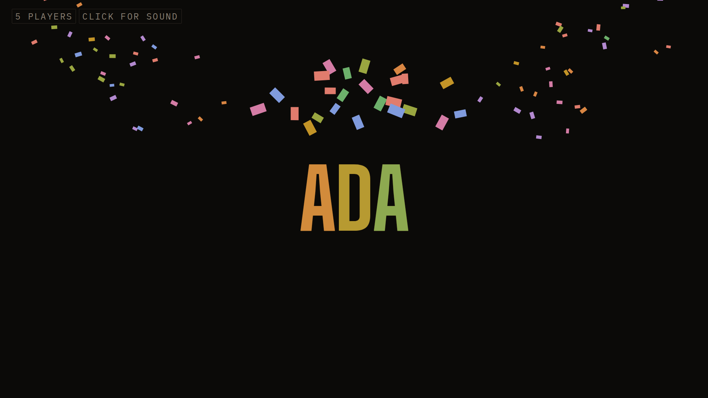
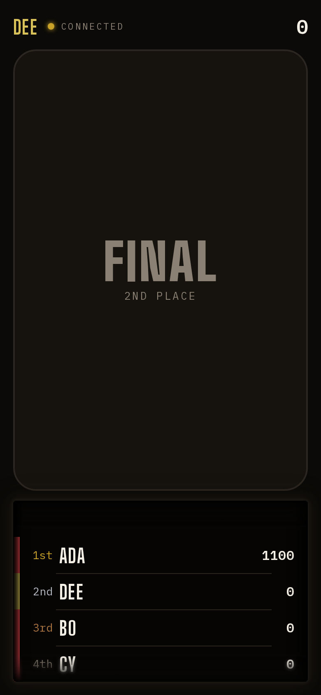

## Opportunity
When the setlist is spent (`idle:finale`, `shared/wall.ts:186`) the wall
builds a brass spotlight (`--finale-build-dur: 2400ms`, `client/style.css:473`),
then shows everyone tied for first in a rainbow with confetti (`FinaleShow`,
`client/Board.tsx:109`). The standings slide back 4 s later
(`style.css:502-514`), and proposal 014's recap cards (the night recap, done)
cycle under the name (`RecapBand`, `Board.tsx:80`). Second and third are
never called out; the room has to find them in the sidebar. Every phone
shows its place the instant the setlist is spent ("Final · 2nd place",
`shared/wall.ts:700-704`), so Bo's phone tells him he came second before the
wall says anything.

## Proposal
The server stamps the time once, and every surface works out the step from
it. `enterBlock` (`server/setlist.ts:53`) runs on both ways to spend the setlist: `next`
through `advanceSetlist` (`state.ts:304`) and `setlistJump` (`state.ts:527`), which a closed
minigame block also goes through (`hub.ts:252`). `state.ts` passes its `now` in
(`setlist.ts` stays pure, like `duel.ts`), and `enterBlock` sets `setlist.spentAt`
when `at` reaches `blocks.length` and clears it when a jump goes back to an
earlier block. A spent setlist with no `spentAt` (an older disk file) counts
as settled. The stamp lives on `SetlistState`, so undo
and disk keep it with the position.
`shared/wall.ts` turns `Wall.finale` into podium tiers (distinct places 1–3
from `state.scores` by score key, as `leaders` reads it today; ties share a tier) plus a pure
`finaleStep(tiers, elapsedMs)` over one schedule constant: build, 3rd, 2nd,
1st. The board and phones each call it with their own synced `now()`
minus `spentAt`. Nothing writes state on a timer.
On the board, 3rd and then 2nd take the middle lane in turn (name and score,
bronze, then silver). Then today's `FinaleShow` plays for 1st unchanged, so 014's
sequence follows as it does now: the recap band 2.5 s after the name and the sidebar at 4 s.
The sidebar stays hidden through the podium steps: the step elements join
the `.board:has(.board__finale-flash, .board__finale)` lists (`style.css:499-501`),
or the standings, 1st on top, would spoil it.
A phone keeps "Final" with no place until its tier's step (`Mine` gains
`called`); 4th and below get their place at the 1st step. The host desk gets "Replay finale", which sends
`setlistJump { at: blocks.length }`. That action is already legal at the
finale and re-stamps `spentAt`, so no new host action is needed.
In: the stamp, the tiers and `finaleStep`, the two podium steps, the phone hold,
the button. Out: night statistics (014 owns them), new sounds, per-minigame
podiums.

Judge: fable, because the pacing of the reveals is taste the spec cannot pin.

## What you'll see
The host presses Next on the last question and the spotlight builds. "3rd · Bo"
lights on the wall and on Bo's phone together, then 2nd, then the winner in confetti. The
recap cards and standings follow as they do now.

## Verification
`npm test`: `shared/wall.test.ts` cases for the tiers (a tie for 2nd leaves no
3rd; one and two players; teams) and `finaleStep` at each boundary.
`server/setlist.test.ts`: `next` and `setlistJump` stamp `spentAt`, and undo
restores the previous stamp. A separate assertion in `client/tunables.test.ts` holds the
schedule's build time to `--finale-build-dur` (it sits outside the
`anim:tunables` block that test reads today). Then `npm run test:review`, `adversarial-qa` on the podium
motion, and a probe on a disposable room
(`npm run probe -- join:Ada,Bo,Cy,Dee setlist:trivia*1 arm buzz:Ada@0 correct next`)
with a phone and the board side by side.

## Shown
- 3rd lights on the wall and the phones hold: `node cache/finale-probe.mjs` (the spec's probe line with `setlist:trivia*3` so the podium has three tiers, a headless board and Bo's phone open through the spend) -> `third        board: "3RD CY & DEE 0" side x=1280 name y=277..443 | phone: "FINAL WATCH THE BOARD"`
- then 2nd, and Bo's phone with it: same run -> `second       board: "2ND BO 100" side x=1280 name y=277..443 | phone: "FINAL 2ND PLACE"`
- then the winner in confetti, the sidebar still out: same run -> `first        board: "ADA ADA" side x=1280 name y=277..443 | phone: "FINAL 2ND PLACE"`
- the recap cards and standings follow as they do now: same run at 13.5 s -> `settled-in   board: "ADA ADA MOST FIRST BUZZES Ada first to buzz 2 times" side x=986`
- Replay finale restarts the ceremony: same run after `jump:3` -> `replay-3rd   board: "3RD CY & DEE 0" side x=1280`
- tiers and `finaleStep` at each boundary: `shared/wall.test.ts` ("the podium: distinct places 1 to 3, a tie for 2nd leaves no 3rd, one and two players, teams", "finaleStep walks build, 3rd, 2nd, 1st at the schedule, skipping places the podium lacks", "finaleCalled: ...")
- `next` and `setlistJump` stamp, undo restores: `server/setlist.test.ts` ("spending the setlist stamps the finale clock; entering a block clears it"), `server/state.test.ts` ("next and a jump to the end stamp the finale clock; a jump back clears it"), `server/hub.test.ts` ("undo restores the finale stamp a Replay replaced")
- the schedule's build time equals `--finale-build-dur`: `client/tunables.test.ts` ("the finale schedule builds for exactly the flash animation")
- `npm run test:review`: `302 passed (1.2m)`, with the new `finale-third` and `finale-second` fixtures
- `adversarial-qa` on the podium motion: three rounds (timing, aesthetics, readability, consistency); round three returned nothing above a nit
- Easy to miss: a board that mounts after the ceremony shows the settled finale, not a replay: same run after `board.reload()` -> `reloaded     board: "ADA ADA MOST FIRST BUZZES Ada first to buzz 2 times" side x=986` (no confetti, sidebar and recap in place at once)
- Not shown: a real phone beside the real TV: the probe drove headless browsers on one box; the room's devices and clocks are the manual checklist's.

## Risks and the alternative considered
A board or phone that mounts after the schedule has run (a reload, or a
restart from disk) must show the settled finale, not replay the build: `FinaleShow` takes a
`settled` prop that skips the confetti and its 2.5 s and 4 s waits. `RecapBand`'s
timers and the CSS sidebar wait start when 1st mounts, which keeps 014
working untouched. If 1st ever stops being `FinaleShow`, both have to move with
it. Alternative considered: start the schedule when each surface first sees
`idle:finale`, as `useClosestHold` does. Rejected because a reload would replay the
ceremony and Replay would need an action of its own.

## Needs from Rick
- Decide whether the standings (board sidebar, phone dial, host, recap) rank a tie as the podium does (a shared place, so Dee is 3rd with Cy) or keep §5's row ranking (Dee 4th); today the podium and each phone's own label share the place and the lists do not.
- Watch one finale on the TV with two phones (manual checklist, the setlist section): the podium's pacing and the phones' hold are taste the probe cannot judge.
