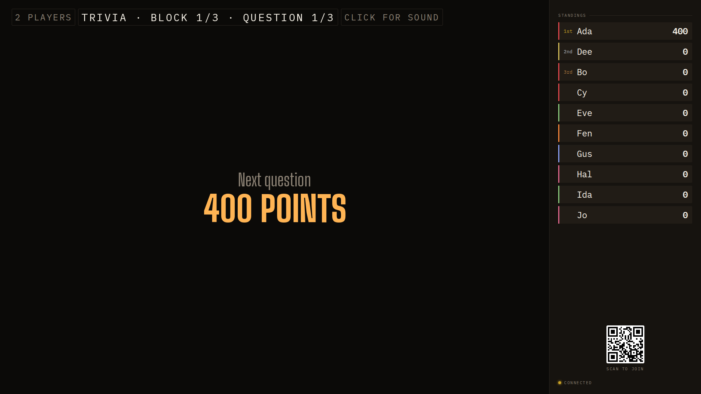
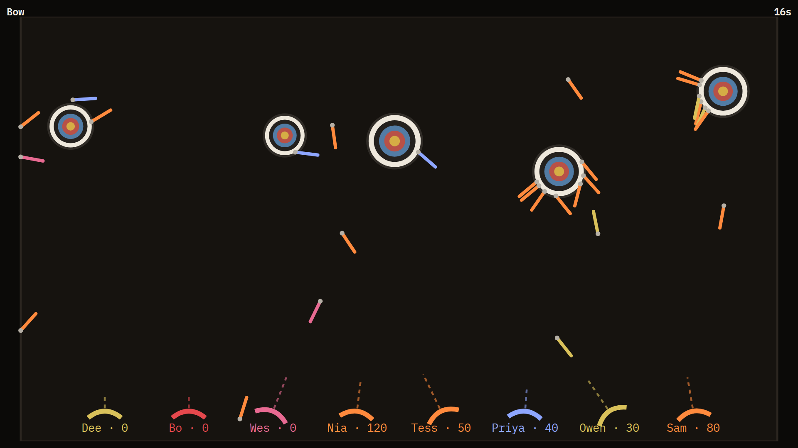
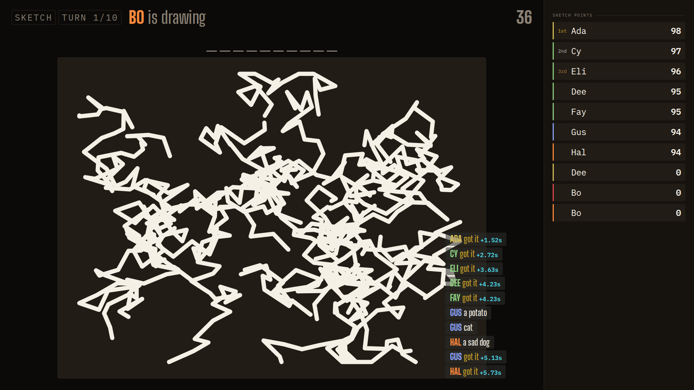

## Opportunity
The quiz board and the minigame boards are different products on the same
TV. The quiz keeps a setlist chip, a players chip, a standings sidebar and
the QR; the moment a block opens Bow, all of it vanishes.

Measured at 1920×1080: Bow's header is "Bow" in 24px mono top-left and "16s"
top-right, no block chip, no standings, no QR, and the night's scores are
nowhere; the match scores sit as 24px mono labels under the bows. Sketch
keeps a sidebar but calls it "SKETCH POINTS" with its own chips ("SKETCH",
"TURN 1/10") styled like the quiz chips but placed differently. Poker is its
own world (fine, it is a table). A guest who joins during Bow has no code to
scan. PRODUCT.md principle 3: "Preserve one continuous game night across the
quiz, setlist blocks, and minigames." The design guide §7 gives the board one
grid: wall left, sidebar right.

## Proposal
A match frame every minigame board renders inside, owned by `Board.tsx`, not
by each minigame: the status row top-left keeps the setlist chip
(`BOW · BLOCK 2/3`) and players chip; the match clock sits top-right in
cyan at `--t-xl` (measurement colour, design guide §1); the sidebar stays,
showing the match standings while the match runs and the night standings
with the match's points folded in on results, and the small QR and lamp stay
at its foot. The field gets the wall's area, so Bow, Tank and Sketch shrink
from full-bleed to the wall; Sketch's own sidebar and chips go. Poker keeps
its table on the wall and gains only the status row and clock.
In: the frame, chip and clock placement, sidebar content per phase, the
four boards' layouts. Out: the fields' drawing code, phone changes, Poker's
table.

Judge: fable, because the field-to-sidebar proportions and what the sidebar
shows mid-match need an eye.

## What you'll see
The board looks like one night: the same chips in the same corner, the same
standings column, a clock where a clock always is, and the QR for a late
arrival whether the room is buzzing or shooting arrows.

## Verification
`npm run build`, `npm test`. `npm run sim-bow -- 1 20`, `sim-tank`,
`sim-sketch`, `sim-poker` on a disposable room at 1920×1080 and 1280×720;
each field still fits without scroll. `npm run review` scenario per minigame.

## Risks and the alternative considered
Bow and Tank fields are sized to the viewport; inside the wall they lose
about 23% of width, which changes aim distances, so the field must scale,
not crop. Alternative: a minigame-owned header component each board calls;
rejected because four owners drift, as they already have.

## Needs from Rick
