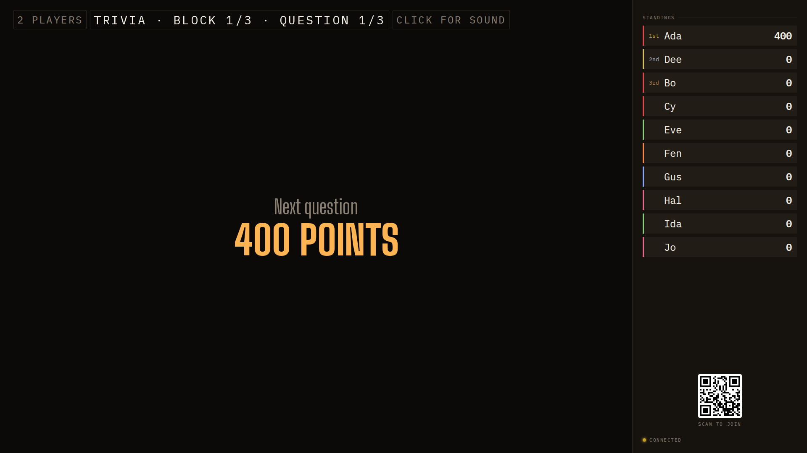
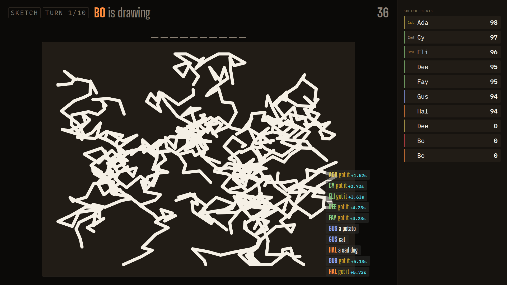

## Opportunity
As soon as a match opens, `Board.tsx` hands the whole screen to that
minigame's board (`client/Board.tsx:574-577`), and the quiz sidebar goes with
it: the standings, the join QR and the lamp (`Board.tsx:814`). Each of the six
minigames then draws its own frame. Ink, Sketch and Poker show the block chip
(`setlistPosition`, `InkBoard.tsx:18`, `SketchBoard.tsx:20`,
`PokerBoard.tsx:75`). Bow, Tank and Tug of war show only their name
(`BowBoard.tsx:44`, `TankBoard.tsx:61`, `TugBoard.tsx:141`). Sketch alone
brings back night standings, at ready (`SketchBoard.tsx:56`). A guest who
arrives during a match has no code to scan, and at the results nobody sees
how the match moved the night's standings. Those standings are already in `state.scores` by
then (`hub.ts:764`).

## Proposal
`Board.tsx` owns it, by phase. While a match is in `ready` or `results`, so
no field is being played, `Board.tsx` renders the minigame's board in the
wall column and the quiz's own sidebar beside it. That sidebar is the standings,
the small QR and the lamp, pulled out of the quiz render as one `RoomSide`
component rather than copied. At results the standings show the night with the
match folded in, and `ScoreChange` animates the jump. Through `countdown` and
`playing`, the minigame's board keeps the whole screen as it does today.
Sketch's own sidebar at ready and results (`SketchBoard.tsx:40,56`) goes,
since `RoomSide` replaces it. Bow, Tank and Tug of war change their title to
`setlistPosition(state) ?? name`, the line Ink, Sketch and Poker already use.
In: `RoomSide`, the phase switch in `Board.tsx`, CSS so the six ready and results
screens fit the wall column, Sketch's two sidebars, three title lines, the
missing review scenarios. Out:
any field's size or drawing during play, clocks, phones, Poker's table, a
QR during play.

How it fits with 041 (Sketch keeps its feed off the canvas, being built): 041
changes Sketch's drawing phase (its feed column and its clock). This spec
touches only Sketch's ready and results branches, so the two don't overlap.
How it fits with 040 (who is in the room): `RoomSide` is the quiz's sidebar,
so 040's dimmed away rows show here too.

Judge: fable, because how the six ready and results screens sit in a narrower
wall needs an eye.

## What you'll see
Bow opens and the standings and QR are still there while phones tap Ready.
The arrows fly full-screen. At the buzzer, the results sit beside the night's
standings as Nia jumps from 4th to 2nd.

## Verification
`npm run build`, `npm test`, then `npm run test:review` in full. Only Ink
and Sketch have review scenarios today (`tools/review/fixtures.ts`), so the
build adds a ready and a results scenario for Bow, Tank, Poker and Tug of
war. All twelve must fit at 1920×1080 and 1280×720. Run `sim-bow`, `sim-tank`, `sim-ink`, `sim-sketch`, `sim-poker` and
`sim-tug` on a disposable room: the sidebar is up at ready and results and
gone during play.

## Risks and the alternative considered
The fields are SVG viewBoxes in world units (`BOW_FIELD`, 1600×900), and aim
comes from the phone, so the board's size never changes gameplay. A sidebar
during play would still cost a quarter of the field's width at 3 m, which is
why it stays out. A long untimed match (Poker, Sketch, Ink) still shows no QR
mid-play. A later upgrade is a corner tag, once review scenarios show a corner that is free in all six.
Alternative considered: a frame around every phase (the first draft). Rejected because it
shrinks the fields while they are being played.

## Needs from Rick
