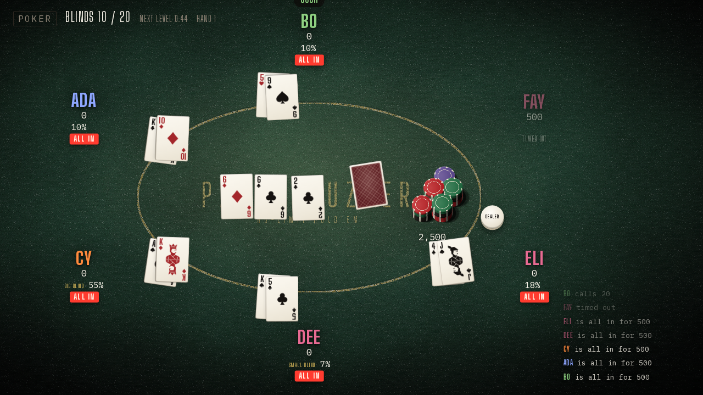
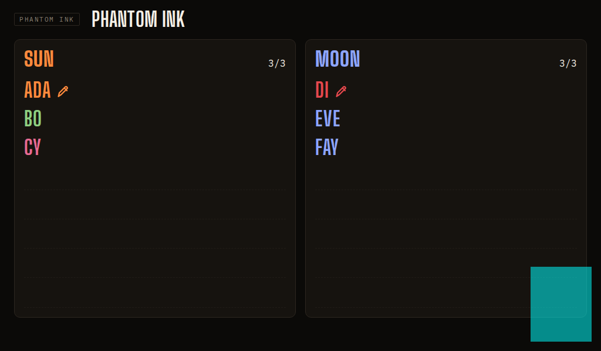

## Opportunity
As soon as a match opens, `Board.tsx` returns the minigame's board alone
(`client/Board.tsx:716-719`), and the join code goes with the quiz sidebar
(`Board.tsx:984-1001`). Sketch gives every player an 80 s turn by default and
Poker doubles its blinds every 10 minutes (`shared/protocol.ts:320-321,326`).
A guest who arrives during either has nothing to scan until it ends. Ready is
where the code pays most: participants are fixed at `startMinigame`
(`server/minigames/runtime.ts:82,90`), so a guest who joins during ready plays
that match. At ready there is no world yet (`runtime.ts:69,215`), so Bow and
Tank show an empty field.

## Proposal
The quiz sidebar's join block becomes one `JoinCode` component with a `small`
form (`.board__qr.is-small`: the QR and "Scan to join", `client/style.css:1293-1295`).
The quiz keeps using it as now: big in the lobby (spec 007), the recap code at
the finale (spec 031). Each minigame board places `<JoinCode small />` inside
its own layout, so the board that owns a corner decides what goes there, and
no rule outside it names a game:
- Sketch: one line in `SketchStandings` (`client/SketchParts.tsx:59-72`), whose
  flex column clips the standings above it as the quiz sidebar does.
- Poker: inside `.felt--board`, top-right; the seats ride an oval centred at
  0.44 of the width (`client/poker.ts:128`) and the log sits bottom-right
  (`style.css:3795`).
- Ink: in its own grid, clear of the lobby panels and the Moon discard column.
- Bow, Tank, Tug of war: in their ready screen and their results `<main>`.

It shows in every phase of an untimed match and at ready and results of a
timed one, hidden only during a timed match's countdown and play (at most
180 s, `protocol.ts:314,317,330`). The registry's `timed` flag
(`client/minigames.tsx:31-48`) is that test, passed to each board, not a
branch per game. A new minigame board has to place it too; the fit-check
scenarios below make a missing one visible.
In: `JoinCode`, its six placements, the review scenarios. Out: any field's
size, the fit checker, phones, the address line (the small form hides it).

Fits with 041 (Sketch's feed column is beside the canvas, the code is in the
standings column) and 036/046 (pills render only on the quiz board).

Judge: opus, because each placement is pinned and the fit check measures it.

## What you'll see
Mid-Poker a "Scan to join" code sits top-right on the felt, clear of the seats
and the log; it stays up through Sketch's drawing and Ink's team picking. Bow
shows it beside the empty field while the room gathers, hides it for the shot
clock, and brings it back at results.

## Verification
`npm test`, `npm run build`, then `npm run test:review` in full at the board
sizes 1280×720 and 1024×600 (`tools/review/fits.spec.ts:23-27`), with no
`data-overlap` on the code. New board scenarios in `tools/review/fixtures.ts`:
Bow, Tank and Tug ready, and their results with eight players; Poker ready
and results; Ink with a full discard column; Sketch drawing with twelve
players. Poker mid-hand has no fixture: run `npm run sim-poker -- 300` on a
disposable room with ten seats and look at both sizes for the seats, the log
and the banners.

## Shown
- Mid-Poker the code sits top-right, clear of the seats, the log and the banners: `npm run sim-poker -- 300 http://127.0.0.1:8391` on a disposable room (six bots plus four idle players, ten seats), then a browser on `/board` at both sizes -> `1024 {"text":"Blinds 20 / 40","banner":[85,25,816,239],"bannerText":[96,63,805,201],"qr":[896,16,1000,142]}`; the mid-hand frames show every seat and the log clear of it at 1280×720 and 1024×600.
- It stays up through Sketch's drawing and Ink's team picking: review scenarios `sketch-drawing-crowd` and `ink-lobby` in `tools/review/fixtures.ts`, which `npm run test:review` fits -> `342 passed (1.4m)`.
- Bow shows it at ready, hides it for the shot clock and brings it back at results: test `the join code hides only while a timed match counts down and plays` in `client/minigames.test.ts`, and scenarios `bow-ready`, `bow-results`.
- `npm test` -> `ℹ fail 0`; `npm run build` -> `✓ built in 905ms`.
- `npm run test:review` in full at 1280×720 and 1024×600, no `data-overlap` on the code: `grep -c data-overlap client/JoinCode.tsx` -> `0`; `npm run test:review` -> `342 passed (1.4m)`.
- New board scenarios: `bow-ready`, `bow-results`, `tank-ready`, `tank-results`, `tug-ready`, `tug-results`, `poker-ready`, `poker-results` (eight players), `ink-discard-full`, `sketch-drawing-crowd` (twelve players), listed in `tools/review.test.ts`.
- Tug results with eight players fit beside the code: winners and the rest now stand side by side under a centred verdict, the code in the right margin at its full size even under a long side name: `node cache/tugcheck.mjs` -> `1280 Night Owls wins {"qr":[1160,1264,574,678],"verdict":[48,1128,81,465],"lists":[441,736,489,700],"scroll":0}`.
- Easy to miss: the registry's `timed` flag is the one test, passed to each board, not a branch per game: `joinShown` in `client/minigame-info.ts`, passed as `join` from `client/Board.tsx`.

## Risks and the alternative considered
A guest arriving mid-play of a timed match waits at most three minutes for
its results. Placing the code per board is six small insertions a future
minigame must repeat. Alternatives considered: a fixed tag rendered by
`Board.tsx` over every board, rejected because the fit check flags it against
each board's full-screen background unless it is exempted, and each board
would still need a CSS rule keyed on its own class to clear the corner; a
sidebar during play, rejected because it shrinks the fields.

## Needs from the operator
- None.
