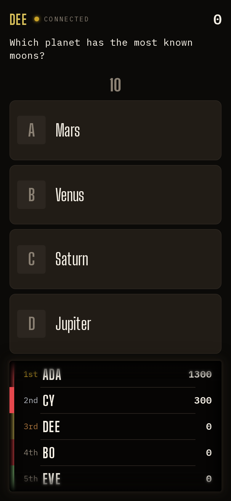
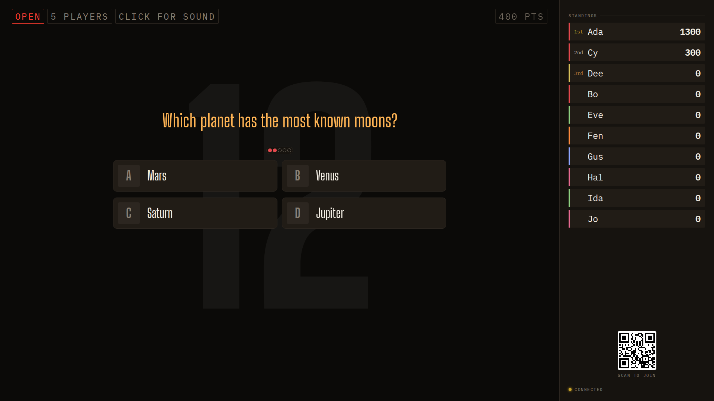

## Opportunity
Nothing lets a player 600 behind in the last block take a swing at first
place, or makes first place sweat. A choice question already gives every
phone a decision. When it settles, `settleChoice` pays the round value to every right
pick, with no mode hook (`server/state.ts:355-361`), so the stakes are the
same for everyone.

## Proposal
One shape: a `wager` mode for choice questions. A spoken, host-judged
version is a different feature and is out.
`server/modes/wager.ts` is typed through `shared/modes/types.ts` and has one
int option, `floor`: anyone may wager up to their score, or up to `floor`
if their score is lower, so a player on 0 still has a bet. While the question is read
(`choice:listening`, `shared/wall.ts:106`), each phone gets the existing number pad
(`GuessPad`, `client/GuessPad.tsx:30`) labelled "Wager", with presets for
none, half and all. A `wager` act goes through the Hub the way `pick` does
(`hub.ts:350`). Its check, `wagerBlockReason`, sits beside `pickBlockReason`
(`server/eligibility.ts:18`): it refuses once the choices are up, a second
wager, more than the limit, and a second phone on the same team, since there is one
wager per score key. Wagers are a round fact (`round.wagers`), redacted to the
phone's own in `viewFor` as picks are, so undo and rebound follow the round.
The mode needs no memory.
Two optional fields join `GameModule`, the interface change that makes this
an L. The first is `wagers: true`, which rides the catalog as `scoreless`
does (`server/modes/index.ts:23`), so the phone and the wall can turn on the
pad and drop "+value" without naming the mode. The second is `choiceAwards(ctx,
correct)`, which `settleChoice` calls in place of its flat payout. The
settle records what it paid as `round.paid`, the way `settleClosest` does,
and the night's ledger reads that instead of `round.value`
(`server/ledger.ts:62-70`), so a right pick's fact carries its wager. The wager
mode's `choiceAwards` returns `wagerAwards(wagers, picks, correct)`, a new
primitive in `shared/scoring.ts`: plus the wager for a right pick, minus it for a wrong pick or none.
`hostStatus` reports "Wagers 6/8 in" on the existing chip (`Host.tsx:410`).
Host-action legality (`shared/legality.ts`) gains nothing, because there is
no new host action. A setlist block names the mode with a pack of choice
questions, and `setlists/full-night.json` ends on one.
In: the mode, the two optional fields, `round.wagers`, `round.paid` on a choice settle, the act and its
check, the primitive, the phone pad, the wall's stamp, the phone's ±
line, a design guide §9 entry for "wager", one setlist line. Out: a spoken or host-judged
wager, a climbing reveal (the standings re-sort with `ScoreChange` instead),
showing amounts on the wall, new sounds.

Judge: fable, because the presets and how the pad feels are taste calls.

## What you'll see
The block's introduction says "Wager". As the question is read, every phone
asks "Wager?". The choices go up, the room picks, and the standings re-sort
as the wagers land.

## Verification
`npm test`: `shared/scoring.test.ts` for `wagerAwards` (none, partial, all
in, no pick, teams). `server/modes/` tests for the limit including `floor`, and refusal
once the choices are up and for a second team phone. A `viewFor` case that one phone
never sees another's wager. A settle test where trivia still pays a flat value, and a ledger test that a wager's fact carries what was paid. Then
`npm run typecheck`, `npm run build`, `npm run test:review`, and a probe
`wager:Ada=200` step so a walkthrough can script it.

## Risks and the alternative considered
The wager window is the time it takes to read the question. A short question
gives a short window. If the room needs longer, the upgrade is a `wagerSec`
option the reader waits out, which is a Reader change. A buzz question in a
wager block plays as trivia, so a wager block needs a pack of choice questions.
Alternative considered: a "double or nothing" toggle on an ordinary question. Rejected
because only the leader plays it.

## Needs from Rick
