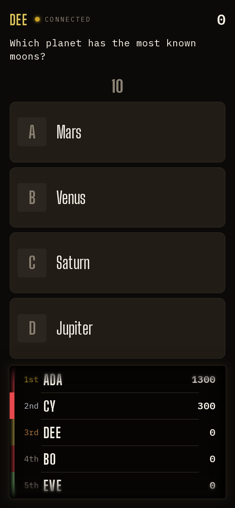

## Opportunity
Every quiz question is first-to-buzz or pick-one. Nothing lets a player who
is 600 behind in the last block take a swing at the leader, and nothing makes
the leader sweat. The choice question already proves the shape a whole-room
question takes on this product: question on the wall, a slot bar that fills
as picks land, a countdown behind the wall, panels on every phone.

PRODUCT.md principle 2 wants "the phone clear and engaging for each player";
on a buzz question nine of ten phones spend the round on "LOCKED". The
wager gives every phone a decision that matters.

## Proposal
A `wager` quiz mode in `server/modes/` using the typed options and memory in
`shared/modes/types.ts`: before the question, each phone shows its own score
and a stepper with presets (0, ¼, ½, all) to wager, with a countdown; the
board shows the slot bar filling as wagers lock, never the amounts. The
question then plays as a choice question (everyone picks) or, for a spoken
answer, as a host-judged round where the host marks each player right or
wrong from a list (`hostStatus` supplies the list). The reveal runs lowest
score to highest: each name, its wager and its new score, so the leader is
last. Scores change through `shared/scoring.ts`. Setlist blocks can name it,
so `full-night` can end on one.
In: the mode, phone wager control, board slot bar and reveal, host marking
list, one starter setlist change. Out: team wagers, items, a new sound set
(reuse stamps and the choice cues).

Judge: fable, because the reveal order, the preset values and how the wager
phone feels are taste calls.

## What you'll see
"Final wager" on the wall; phones ask "How much?"; the slot bar fills; the
question plays; then the reveal climbs the standings one phone at a time to
the leader, who may or may not still be the leader.

## Verification
`npm test` (mode tests under `server/modes/`, scoring cases for zero, partial
and all-in wagers, late wagers refused), `npm run typecheck`, `npm run build`.
A probe step for `wager:A=200` so a walkthrough can script it.

## Risks and the alternative considered
It is an `L`: a new mode touches the protocol, legality, phone and board.
The host marking list is the risky surface; keep it one row per player with
Right/Wrong, nothing more. Alternative: a "double or nothing" toggle on an
ordinary question; rejected because only the buzzer gets to play it.
Proposal 011 (bluff round) is a different whole-room kind, about writing
lies; this one is about risking your own score, and both can share the
slot bar and pick panels.

## Needs from Rick
