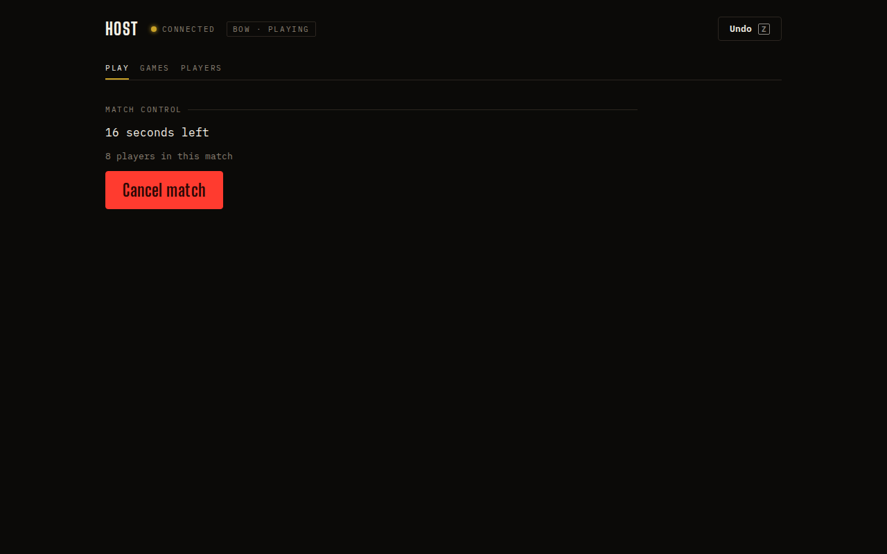
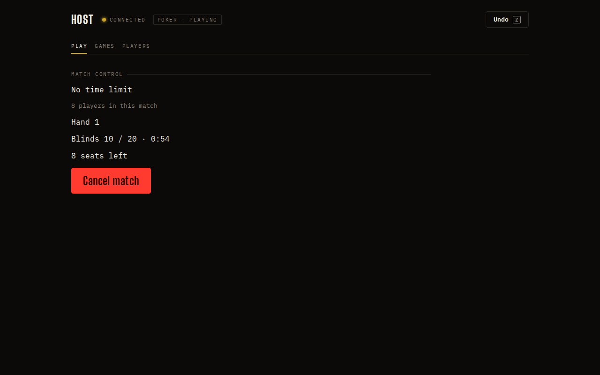
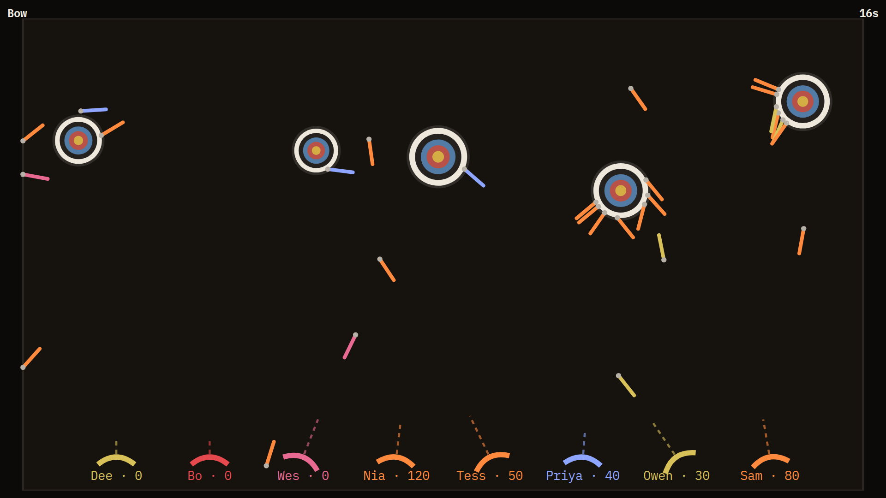

## Opportunity
During a match, the host's `MatchDesk` (`client/Host.tsx:38-82`) shows the
clock, "N players in this match", the definition's `hostStatus` lines, and
Cancel. Only Poker supplies those lines (`server/minigames/poker/definition.ts:124`):
hand, blinds, seats left. Mid-match the host cannot see who is scoring, who
has not fired a shot, who folded, or who dropped. Results already list every
player's points or place, with Play again and Close (`Host.tsx:68-79`), so
results are covered and live play is the gap.

## Proposal
The host's frame carries rows. Each minigame's knowledge stays in its
definition, the way `hostStatus` already works, and `Host.tsx` renders the
rows without naming a minigame. Today the runtime sends the host a useless
`spectator` frame on every pump: `frameFor` treats any role other than board
as a player (`server/minigames/runtime.ts:211-221`), and the host's
`useSocket` stores it (`client/useSocket.ts:168`). Instead, `frameFor('host')`
returns `{ role: 'host', rows }`, built by a new optional definition hook
`hostRows(world, clock)` (`server/minigames/definition.ts`). A row is
`{ players, score?, word? }`, a type in `shared/protocol.ts`. `MatchDesk`
lists the rows by `score` descending (unscored rows after, in the hook's order), with each player's identity colour and
connection lamp (from `state.players`, so no minigame's code is involved), keyed
by the first player's id.
The six hooks:
- Bow: a row per archer with score; "no shot" until they fire one.
- Tank: a row per crew (driver and gunner) with score; "destroyed" while down.
- Ink: a row per team with no score; the word names the team's part of the
  turn's `InkStep` (`server/minigames/ink/types.ts:18-27`), one plain word
  per variant, listed in the hook and tested for every variant.
- Sketch: score; "drawing" for the drawer and "guessed" for anyone who got the word this turn.
- Poker: chip stack as the score; "folded", "all in" or "out".
- Tug of war: a row per player (`pullers[id].pull`, `tug/world.ts:22`) as
  the score, with the side as the word, so the host sees who isn't pulling.
In: the row type, the host frame, six hooks, the `MatchDesk` list. Out:
controlling a minigame from the desk, kicking a player, Poker's feed,
changes to results.

Judge: opus, because the rows and words are pinned and the work is six small
projections plus one list.

## What you'll see
The host glances down during Bow and sees "Nia 120 · Sam 80 · Dee 0 no shot",
so they know Dee hasn't worked out the drag. During Poker, Bo's row reads "folded" and Cy's lamp is
off.

## Verification
`npm test`: a world-level test of `hostRows` for each definition (Bow's
"no shot" clearing on the first release, Poker's words through a fold and a
bust, a destroyed Tank crew), and a runtime test that the host gets a `host`
frame and a phone still gets its own frame. `npm run build`, then
`sim-bow`, `sim-tank`, `sim-ink`, `sim-sketch`, `sim-poker` and `sim-tug` on a
disposable room with `/host` open at 1280×800.

## Risks and the alternative considered
It is an M: the frame union gains a `host` variant and the definition an
optional hook, both additive, so no current surface or definition changes
unless it wants rows. Host frames go out at the board's cadence. That costs nothing new, since the host already receives a
frame per pump, and Poker's `frameKey` still suppresses them between actions.
Alternative considered: compute the rows in the browser from the board frame, through a function per
row in `client/minigames.tsx`. Rejected because it ships the whole field
(Tank's cover) to the host, and the facts it needs (shots, folds) belong to
the world.

## Needs from Rick
