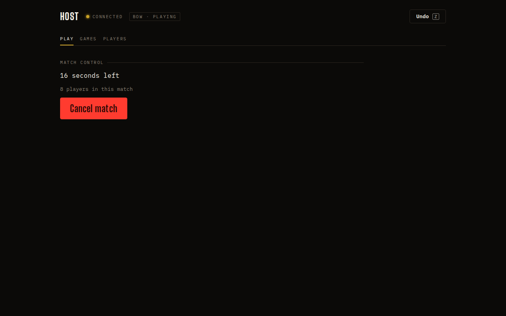
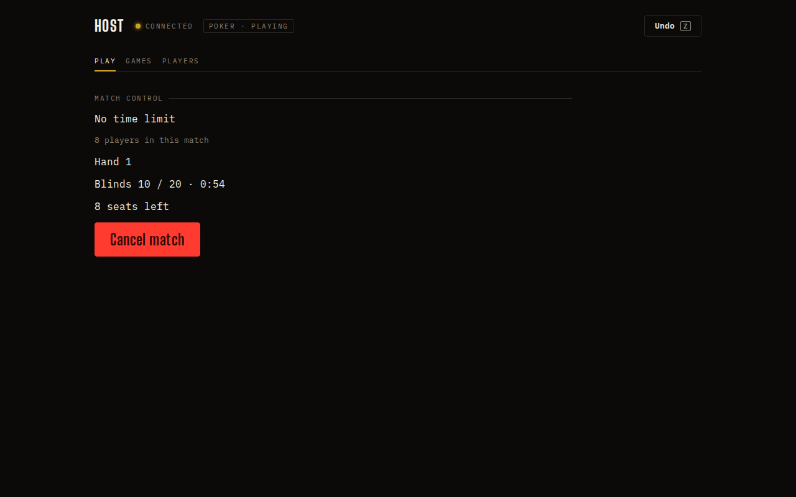

## Opportunity
During a minigame the host's Play tab is three lines and a red button.

Measured at 1280×800 during a Bow match: "16 seconds left", "8 players in
this match", Cancel match, then 500px of nothing. Poker adds the hand, blinds
and "8 seats left". The host cannot see who is scoring, who has not fired a
shot, who is disconnected, or what the match will do when it ends. The board
has all of it, but the host is at a laptop facing the room. PRODUCT.md
principle 1: "Give the host a clear view of progress, the room's current
moment, and the next valid action."

## Proposal
A match desk under Match control, fed through the minigame's existing frame
and results and shaped like the quiz desk's compact standings: one row per
participant (or crew) with identity colour, live match points, and a small
state word the minigame supplies (`idle` for no shot yet, `drawing`,
`folded`, `out`, `disconnected`), sorted by points. On results, the same rows
freeze with the awarded night points and the two next actions, Replay and
Close, sit where Arm and Next sit, with the one that moves the setlist on
labelled so. The state word comes from a small per-minigame projection in
`client/minigames.tsx`, not a branch in `Host.tsx`.
In: the rows, the state words, the results actions. Out: controlling a
minigame from the desk, kicking a player mid-match, Poker's full feed.

Judge: opus, because the rows and words are pinned here and the work is
wiring each minigame's frame into one list.

## What you'll see
The host glances down and sees "Nia 120 · Sam 80 · Dee 0 idle" during Bow,
knows Dee has not found the drag, and after the buzzer sees exactly what was
added to whose score before pressing Close.

## Verification
`npm run build`, `npm test`. `npm run sim-bow -- 1 20`, `sim-tank`,
`sim-sketch`, `sim-poker` on a disposable room with `/host` at 1280×800;
rows update live and the results rows match the board.

## Risks and the alternative considered
Poker frames arrive often; the list must key rows by player id so it does not
re-mount. Alternative: embed the board's field in the host page; rejected
because a 1280-wide desk has no room and the host needs numbers, not arrows.

## Needs from Rick
