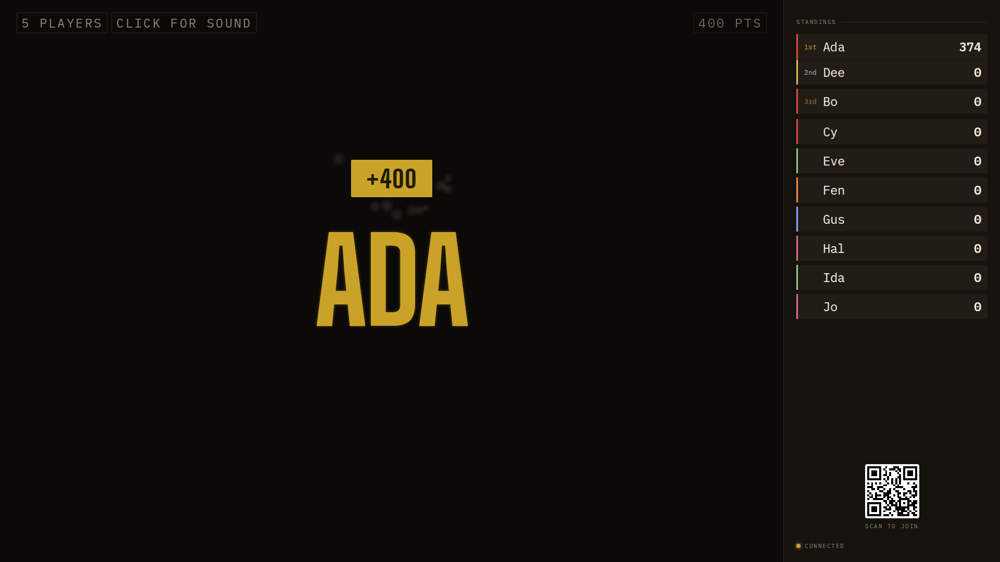
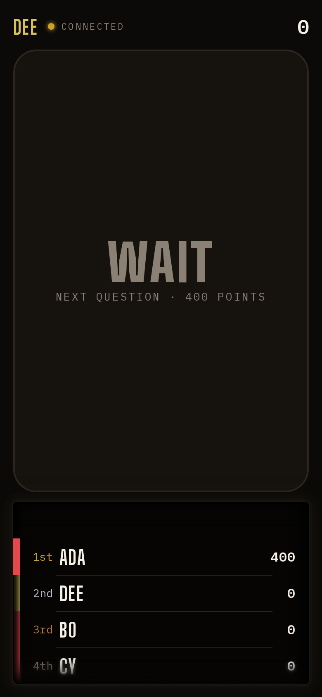

## Opportunity
When Ada is awarded, the board slams "+400 ADA" in brass. Dee's phone, in the
same second, says "WAIT · NEXT QUESTION · 400 POINTS".

The verdict reaches nine of ten phones only as a row shuffling in the dial.
The design guide's phone table (§7) lists a label for every state of *your*
buzzer and none for what just happened to someone else, and the phone's own
"Right" is the only verdict a phone ever shows. A phone face-down on a knee,
which the guide says it may be, learns nothing. PRODUCT.md principle 2 asks
for phones "equally clear and engaging for each player".

## Proposal
`phoneOf` in `shared/wall.ts` gains a `verdict` mood for phones that are not
the leader, for the award's dwell: label the scorer's name in their identity
colour, sub "+400 · right" (brass) or "−200 · wrong, rebound opening" (tally),
using the facts every role already has (`award`, the leader's name and
colour). The buzzer card takes the tone the board's hero takes (proposal
008's tones). A short haptic distinct from the three in the guide marks it;
no tone, since the room hears the board. The leader's own phone keeps
"Right"/"Out" as today. After the dwell the phone returns to Wait.
In: one mood, two strings, one haptic. Out: the order, deltas, or anything
`viewFor` redacts.

Judge: opus, because the mood, strings and timing are pinned and the work is
one projection case plus its tests.

Built as specified, with four changes from the adversarial QA rounds:
- The name takes the hero's tone, brass or tally, rather than the scorer's
  identity colour. Identity red and gold read as the opposite verdict, and an
  edge on this card already means a state. The subtitle is in chalk, because
  §2 rules out small tally text on the panel.
- A miss shows only while a held rebound waits. A rebound that opens at once
  has 300ms, which is too short to read and ends in the buzzers-open cue.
- The name waits until the board has finished typing the transcript, so it
  never comes before the line.
- The haptic is three light ticks, `[20, 70, 20, 70, 20]`, so it can't be
  mistaken for the buzzers-open double tap.

## What you'll see
Ada answers; every phone in the room flashes "ADA · +400 · right" in brass
and buzzes once, then settles to Wait. A wrong answer shows the same in tally
with "rebound opening", so the others know the floor is about to open.

## Verification
`npm test` (`shared/wall.test.ts` gains the non-leader award and penalty
cases; redaction cases unchanged), `npm run build`. `npm run review` phone
scenario at the award for a non-leader.

## Shown
- Every other phone shows the scorer and "+400 · right": `node cache/shots/shoot.mjs cache/shots` (review scenario `correct`, Bo's phone) -> `correct bo "ADA\n+400 · RIGHT"`
- A held miss shows "wrong, rebound opening": same run -> `wrong-hold bo "ADA\n−100 · WRONG, REBOUND OPENING"`
- The answerer keeps Right/Out: same run -> `correct ada "RIGHT\n+400"` and `wrong-hold ada "OUT\nWRONG ANSWER — YOU SIT OUT THE REST OF THIS QUESTION"`
- Settles to Wait once the next arm clears the award, and the miss ends when the buzzers open: `shared/wall.test.ts` test "every other phone feels the verdict, and only while it stands"
- `npm test` with the non-leader award and penalty cases: `npm test` -> `ℹ fail 0`; redaction cases unchanged (no `viewFor` change in the diff)
- `npm run build`: `npm run build` -> `✓ built in 741ms`
- Layout fit of every review scenario: `npm run test:review` -> `294 passed (1.1m)`
- Long names stay on one line: name injected into the card at 320 and 390 wide -> `320 correct Bartholomewsworthing {"h":18,"fs":"20.4px","w":272,"card":288}`
- Easy to miss: the name must not come before the board's typed transcript, and the player who missed never sees their own name: `useTold` and the `told.name !== me?.name` check in `client/Player.tsx`, with the timing in `settleMs` in `client/Spoken.tsx`
- Not shown: the haptic on a real phone. Nothing here can vibrate, and Rick tests feel by hand.
- Not shown: the interactive `npm run review` workbench. It opens Chrome on the Mac; the same scenarios were shot headless through `review-frame.html` instead.

## Risks and the alternative considered
A phone cannot know the dwell ends unless the state says so; use the same
`award` lifetime the board uses, which already clears on arm. Alternative: a
toast above the dial; rejected because the buzzer card is the phone's one
object and a second surface competes with it.

## Needs from Rick
- [a phone] On a held miss (autoplay with the box reading), feel the three-tick verdict haptic, then the buzzers-open cue a few seconds later, and say whether they're distinct enough (docs/manual-checklist.md).
