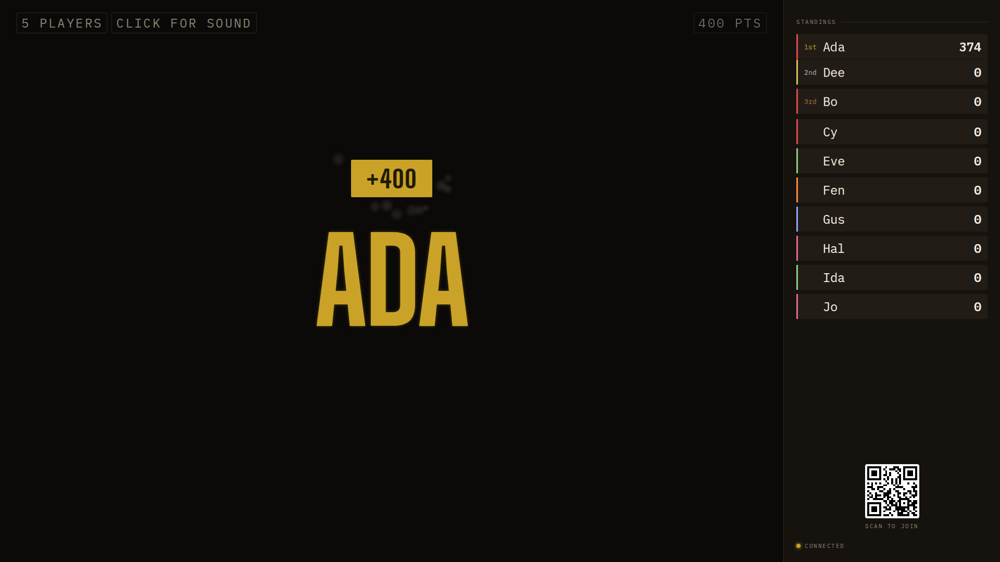
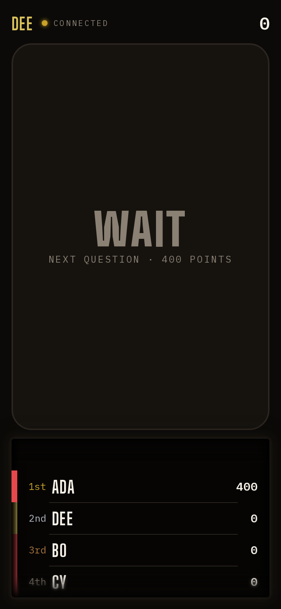

## Opportunity
When Ada is awarded, the board slams "+400 ADA" in brass. Dee's phone, in the
same second, says "WAIT · NEXT QUESTION · 400 POINTS".

The verdict reaches nine of ten phones only as a row shuffling in the dial.
The design guide's phone table (§7) lists a label for every state of *your*
buzzer and none for what just happened to someone else, and the phone's own
"Right" is the only verdict a phone ever shows. A phone face-down on a knee,
which the guide says it may be, learns nothing. PRODUCT.md principle 2 asks
for phones "equally clear and engaging for each player".

## Proposal
`phoneOf` in `shared/wall.ts` gains a `verdict` mood for phones that are not
the leader, for the award's dwell: label the scorer's name in their identity
colour, sub "+400 · right" (brass) or "−200 · wrong, rebound opening" (tally),
using the facts every role already has (`award`, the leader's name and
colour). The buzzer card takes the tone the board's hero takes (proposal
008's tones). A short haptic distinct from the three in the guide marks it;
no tone, since the room hears the board. The leader's own phone keeps
"Right"/"Out" as today. After the dwell the phone returns to Wait.
In: one mood, two strings, one haptic. Out: the order, deltas, or anything
`viewFor` redacts.

Judge: opus, because the mood, strings and timing are pinned and the work is
one projection case plus its tests.

## What you'll see
Ada answers; every phone in the room flashes "ADA · +400 · right" in brass
and buzzes once, then settles to Wait. A wrong answer shows the same in tally
with "rebound opening", so the others know the floor is about to open.

## Verification
`npm test` (`shared/wall.test.ts` gains the non-leader award and penalty
cases; redaction cases unchanged), `npm run build`. `npm run review` phone
scenario at the award for a non-leader.

## Risks and the alternative considered
A phone cannot know the dwell ends unless the state says so; use the same
`award` lifetime the board uses, which already clears on arm. Alternative: a
toast above the dial; rejected because the buzzer card is the phone's one
object and a second surface competes with it.

## Needs from Rick
