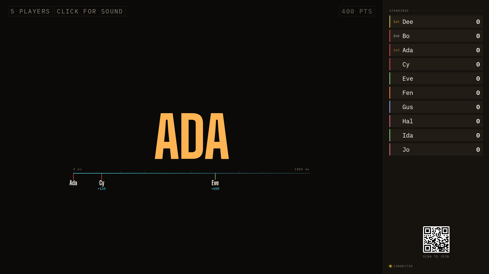
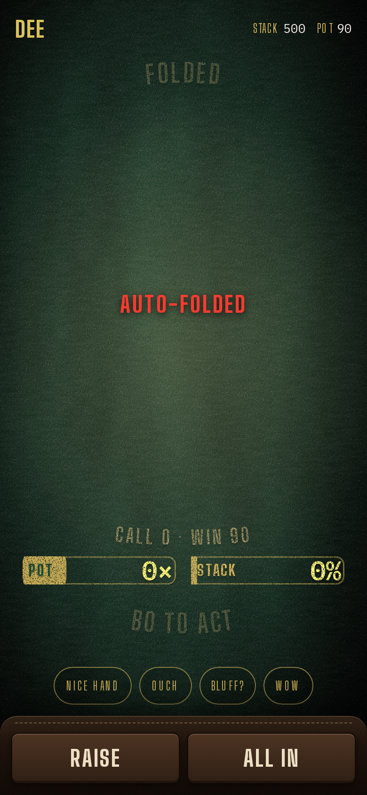

## Opportunity
Poker phones have four reactions (Nice hand, Ouch, Bluff?, Wow;
`REACT_LABEL`, `shared/protocol.ts:336`). They float up from a seat, one per
player every 3 s. The quiz, where nine phones sit locked while one person
answers, has none. Poker's version cannot be lent to the quiz. A reaction is
a Poker input (`protocol.ts:361`), applied inside the Poker world with a
cooldown counted in world ticks (`server/minigames/poker/definition.ts:10,88-95`),
kept in the world (at most 10), and shipped in Poker's frame
(`protocol.ts:400`). Without a match there is no world for it to live in.

## Proposal
Follow the lobby's practice buzz, not items or modes. A practice buzz is a
client message the Hub checks and relays as a receipt that never enters State
(`hub.ts:477-487`). Browsers keep receipts locally (`client/arrival-feedback.ts`).
Quiz reactions take the same path. A phone sends `{ t: 'react', kind }`. The
Hub checks `reactBlockReason(state, playerId)`, which sits beside
`pickBlockReason` in `server/eligibility.ts` and allows a reaction only from state facts the server has: `phase === 'LOCKED'`
and the sender is not `order[0]`, or `round.award` is set for the current
`questionId` (until the next arm or question clears it); never under an
arrival or a minigame. A 3 s per-player
cooldown lives in private Hub memory beside `practiceSeq` (`hub.ts:98`).
The Hub relays `{ t: 'reaction', receipt: { questionId, seq, playerId, kind } }`
to board connections only. There is no undo, no snapshot and no `viewFor` change.
The four words (Ooh, No way, Too slow, Legend; the words are a taste call)
are a `QUIZ_REACT_LABEL` beside Poker's, which stays as it is.
`phoneOf` gains a `react` flag on `Phone`, not a mood, so it composes with
the verdict mood that 035 (phones feel the verdict, being built) adds. The phone shows the row
under its card whenever the flag is set. `useSocket` keeps incoming receipts for the board. The phone dims the row
for its 3 s after a tap so a dropped tap is never silent. On the board, a
pure `shownPills(receipts, now, cap)` in a client module beside
`client/arrival-feedback.ts`
keeps at most 6 pills up for the current `questionId` and folds the rest into one "+N"
chip. Each pill rises from the wall's bottom edge in the sender's
colour with `fx-rise` and fades before the middle lane.
In: the message pair, the check and cooldown, the words, the phone flag and
row, the board layer and its cap. Out: a host off switch (the cooldown and
cap keep it quiet; add one if a night proves it needs one), sounds,
free text, emoji, reactions in a lobby, an introduction or a minigame,
moving Poker onto this path.

Judge: fable, because the pill motion and the four words need judgment.

## What you'll see
Ada buzzes, and a few "Too slow" pills in six colours drift up from the foot
of the wall. She gets it wrong, the room says "Ooh", and a "+9" chip
shows how many more said it. Nothing covers the name or the stamp.

## Verification
`npm test`: `reactBlockReason` by state (locked and answering, the leader refused,
an award up, idle, an arrival, a minigame), the cooldown under `node:test`
mock timers (the Hub reads `Date.now()` directly),
`shownPills` capping and coalescing, and receipts for an old `questionId`
dropped. `npm run build`, `npm run test:review`, then `adversarial-qa` on
the pill motion. A probe `react:Ada=ooh` step lets a walkthrough send twenty
at once on a disposable room and show the wall stays readable.

## Risks and the alternative considered
Twenty phones at one per 3 s is about seven a second. The cap of 6 and the
count chip are what keep the timeline readable. The cap is a board constant,
tuned in `adversarial-qa`, which looks specifically where pills cross
`board__below` (the timeline and lockout chips, at room scale since 038). Alternatives considered: make reactions an item
grant (rejected: an item is a grant the item framework executes against
state, and a reaction changes nothing), or put them in State (rejected:
undo and disk would carry chatter). A laugh-track cue the host triggers was
also rejected, because it gives the host more to do and the room nothing.

## Needs from Rick
