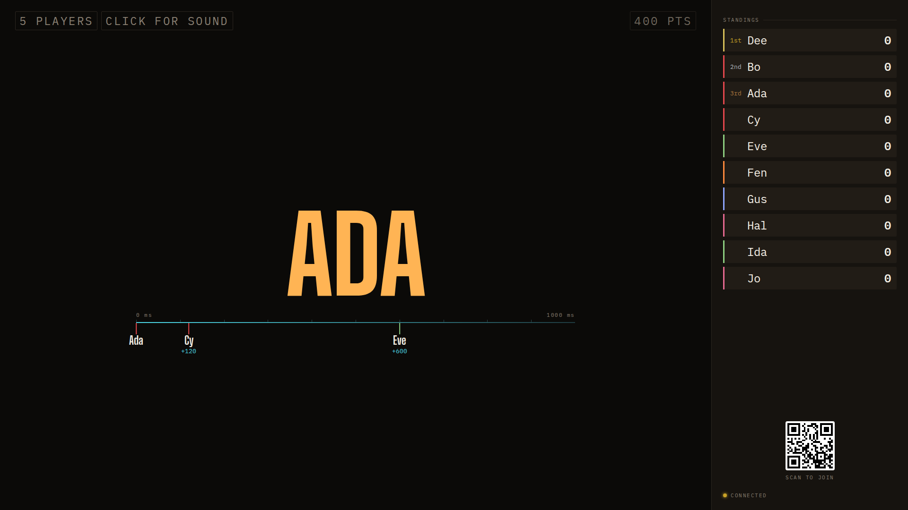
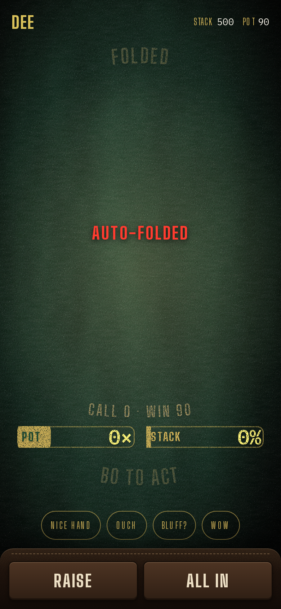

## Opportunity
Poker phones have four reactions (Nice hand, Ouch, Bluff?, Wow) that float
up from a seat on the table, one per player every 3 seconds
(`shared/protocol.ts:323`). The quiz, where nine phones sit locked while one
person answers, has none.

During a buzz question the wall is one name and a timeline; the rest of the
room is an audience with nothing to do but wait for the host. The design
guide calls the board "a television studio floor", and a studio floor has an
audience. PRODUCT.md principle 2: phones should be "equally clear and
engaging for each player", not only the one who buzzed.

## Proposal
Lift Poker's reaction act into the item and phone framework so the quiz can
use it: while someone is answering or a verdict is dwelling, a locked phone
shows a row of four pills under the buzzer (Ooh, No way, Too slow, Legend;
words are a taste call) with the same 3-second cooldown. On the wall each
reaction rises as a small pill in the sender's identity colour from the
bottom edge of the wall, over the timeline, and fades in a second, using the
interest kit (`fx-rise`, `fx-pop`) so it never competes with the hero. The
host desk shows nothing; the host has the room. A host setting turns it off
for a quieter night.
In: the act, the phone row for `Locked`/`verdict` moods, the wall layer, the
setting. Out: free-text, emoji, sounds, reactions during a lobby or an
introduction.

Judge: fable, because the pill motion, where it rises and the four words
need judgment.

## What you'll see
Ada buzzes and a flurry of tiny "Too slow" pills in six colours drifts up
the wall from the people she beat; she gets it wrong and the room says "Ooh".
Nothing covers the name or the stamp.

## Verification
`npm test` (act legality by phase, cooldown, redaction untouched),
`npm run build`, then `adversarial-qa` on the pill motion. Probe gains a
`react:A=ooh` step so a walkthrough can send twenty at once and prove the
wall stays readable.

## Risks and the alternative considered
Twenty phones reacting at once could bury the timeline; cap concurrent pills
on the wall and let the rest coalesce into a count. Alternative: a laugh
track cue the host triggers; rejected because it gives the host more to do
and the room nothing.

## Needs from Rick
