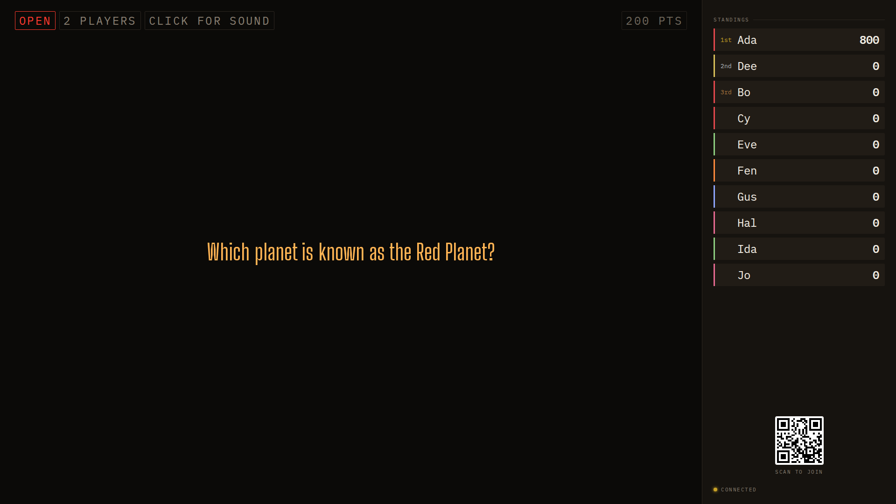
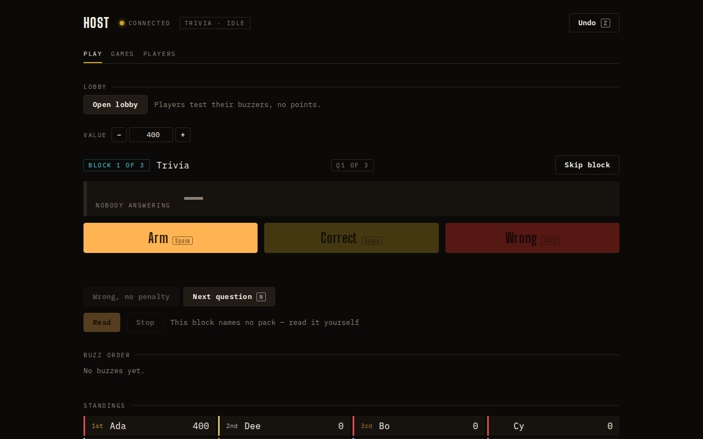

## Opportunity
When a pack is read, the question is on the wall even when no speech is
available; the reader still shows the text and arms.

Without a pack the host reads from paper and the wall shows "Ready" or the
value. The host desk says so itself: "This block names no pack — read it
yourself".

A host with a quiz on a sheet, or a question that just came to mind, cannot
put it on the wall without writing a pack file and restarting the pack
chooser. Two of three starter setlist blocks in `testflow1` name no pack.

## Proposal
A one-line input on the Play desk beside Read, "Question for the wall",
with Show (Enter) and Clear. Show sends the text as the round's clue through
the same path the reader uses (`round` clue text, `board__spoken` on the
wall, mirrored to phones when "Mirror question text to phones" is on), so
every surface treats it exactly like a read question. Arming keeps it; Next
clears it and empties the input. It is runtime, not in the snapshot, and
undo does not touch it.
In: the input, one host act, reuse of the clue path. Out: answers, packs,
speech, saving typed questions.

Judge: opus, because the behaviour is fully pinned to the reader's existing
clue path and the work is one act and one field.

## What you'll see
The host types "Which Beatle was the youngest?" and presses Enter; the wall
shows it in the reader's type; Arm, buzz, score; Next clears it.

## Verification
`npm test` (the act is refused during an introduction and a minigame like
Read is; a cleared clue leaves no trace in `viewFor` for phones unless mirror
is on), `npm run build`. Walk it on a disposable room.

## Risks and the alternative considered
The host keyboard shortcuts must stay dead while focus is in the input; the
guide already requires that for inputs. Alternative: an "ad hoc pack" editor;
rejected as a bigger tool for a sentence.

## Needs from Rick
