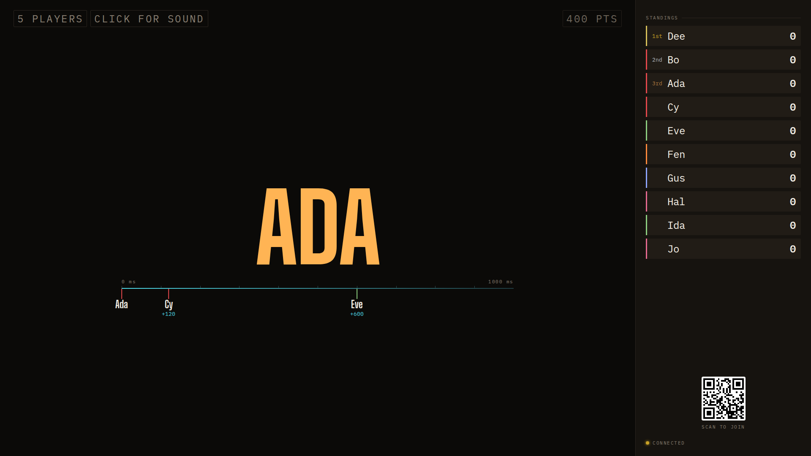

## Opportunity
The timeline is "the signature" (design guide §6), the one thing that makes
this a timing instrument and not a buzzer. Its numbers are the smallest type
on the board.

Measured at 1920×1080: `.timeline__ms` is `--t-sm` (13px, `client/style.css:347`),
`.timeline__name` is `--t-lg` (24px), the scale labels "0 ms" and "1000 ms"
are `--t-xs` (11px). The hero above them is 280px. Design guide §3: "Board
type is viewport-relative because it is read across a room. Host and phone
type is fixed because it is read at arm's length. Don't mix the two." These
three are fixed-rem host sizes on the board, the same fault proposal 006
fixed for the chips. "+120" is the fact the room wants after the slam, and
from the sofa it is a cyan smudge.

## Proposal
Board tiers for the three timeline labels in `client/style.css`, scoped to
`.board__wall .timeline`: names at `--t-xl` (clamp 28–48px), deltas at
`--t-chip-board` × 1.2 (about 29px at 1920) keeping `--cyan` and tabular
numerals, scale labels at `--t-chip-board`. Pin height and rail unchanged.
The motion workbench's timeline scenario stays as is for the host desk, which
also renders a timeline at the fixed sizes.
In: three selectors. Out: the host timeline, the pin motion, the rail.

Judge: sonnet, because the sizes are given and the change is three
declarations.

## What you'll see
Under the hero, "Cy +120" and "Eve +600" read from across the room without
leaning in; the rail is the same, the names keep their background so pins
still break around them.

## Verification
`npm run build`. Re-shoot the photo-finish scenario (`npm run anim`) at
1920×1080 and 1280×720 and check four names at 1280 do not overlap on the
rail; `adversarial-qa` readability critic on the frame.

## Shown
- Names at `--t-xl`, deltas at 1.2 x chip, scale at chip: computed styles read from the running board at 1920x1080: Ada `48px`, `+600` `28.8px`, scale `24px`; at 1280x720: `43.52px`, `19.2px`, `16px`.
- Rail and pin motion unchanged: `git diff main...HEAD --stat` -> `client/Board.tsx`, `client/style.css` only; the pin/rail rules are not edited, only lane pitch became `--lane-h` (same 2.6rem default).
- Host/workbench timeline keeps fixed sizes: the new rules are all under `.board__wall .timeline`.
- Build and fit: `npm run build` -> `built in 1.82s`; `npm run test:review` -> `294 passed`; `npm test` -> `ℹ fail 0`.
- Four names at 1280 do not overlap: `Ada@0,Bo@250,Cy@500,Dee@750` at 1280x720 -> lowest label bottom 593 of 720, one row; `Ada@0,Bo@40` -> bottom 684 of 720.
- Readability critic (sonnet, fresh) on the 1920 and 1280 frames: no blockers; two minor notes on the three-buzz staircase (stems 17px apart), left as is.
- Easy to miss: lane pitch and the lane estimate must grow with the labels: `--lane-h` in style.css and `labelWidth` in `client/Board.tsx`; at 1920 three buzzes at 0/40/60ms staggered into three rows with no overlap (Ada, Bo, Cy tops 726, 817, 907).
- Not shown: three buzzes within 60ms at 1280x720: the third row now runs off the bottom (label bottom 830 of 720; was 600 before), see Risks.

## Risks and the alternative considered
Scope grew a little: the lane pitch (`--lane-h`) and `labelWidth` in Board.tsx follow the bigger labels, or the rows collide. Known limit: at 1280x720, three buzzes within about 60ms stagger into three rows that no longer fit the screen height (one or two rows do). Four close buzzes (within 60ms) could overlap at the larger size; the
existing stagger of label rows handles two, and a third row is cheap.
Alternative: show only the first delta large; rejected because the field
filling in is the race the guide says to watch live.

## Needs from Rick
