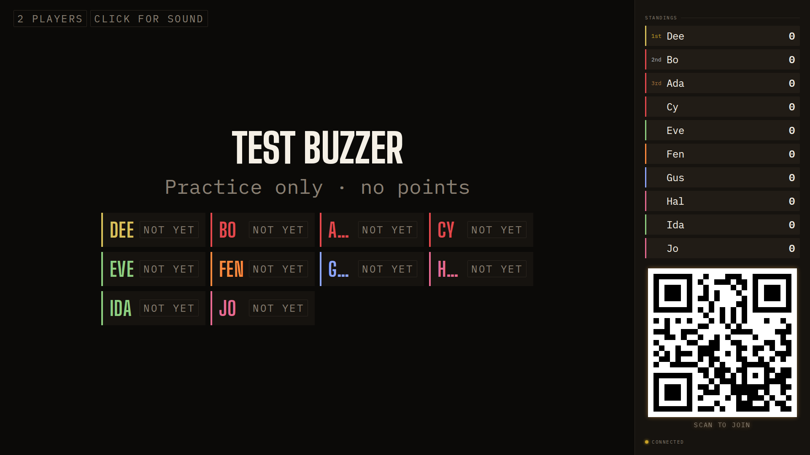

## Opportunity
In the lobby the board lists every player as a tile with a Tested/Not yet
chip. Three-letter names do not fit the tile.

Measured at 1920×1080 with ten players: Ada, Gus and Hal render as "A…",
"G…", "H…". The tile grid is `minmax(14rem, 1fr)` (`client/arrival-board.css:34`),
the name is `--t-xl` (48px) with `text-overflow: ellipsis`, and the chip
beside it is `--t-chip-board` uppercase mono, about 130px wide for "NOT YET";
what is left for the name is under 60px when the row holds four tiles. The
lobby's one job (design guide §7, Arrival) is arrival: a guest looks for
their name and sees a letter.

## Proposal
Let the name win the tile: `.arrival-board__name` gets `flex: 1 1 auto` and
drops the ellipsis in favour of `overflow-wrap: anywhere` at `--t-lg`-to-
`--t-xl` via `clamp`, and the chip gets `flex: none` and the short words
"Tested" / "Not yet" at `--t-chip-board` × 0.85. Raise the tile minimum to
`18rem` so at 1920 the roster is three tiles wide for ten players and never
four. Nothing else moves.
In: three CSS rules. Out: the chip words, the lit flash, the host or phone
lobby.

Judge: sonnet, because the measurements and rules are given.

## What you'll see
"ADA  Not yet", "GUS  Not yet", "HAL  Not yet" in full at 1920 and at 1280,
twelve players in four rows of three, no ellipsis.

## Verification
`npm run build`. Open the lobby on a disposable room with twelve players
(`npm run probe -- join:...`) at 1920×1080 and 1280×720 and confirm no tile
truncates; `npm run review` lobby scenario.

## Risks and the alternative considered
A twelve-letter name still wraps to two lines, which is the right failure.
Alternative: drop the chip and light only tested names; rejected because
"Not yet" is what the host reads across the room to chase stragglers.

## Needs from Rick
