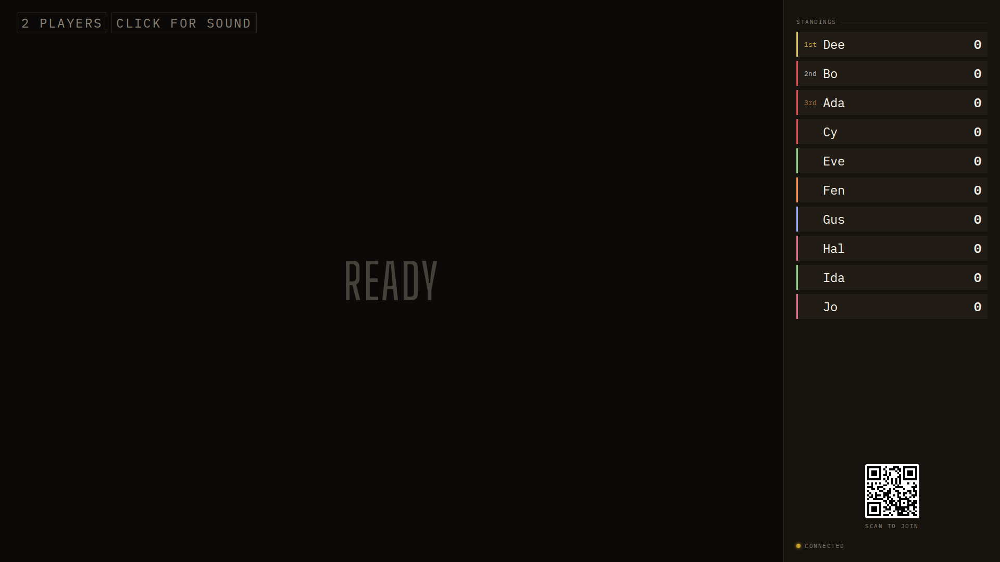
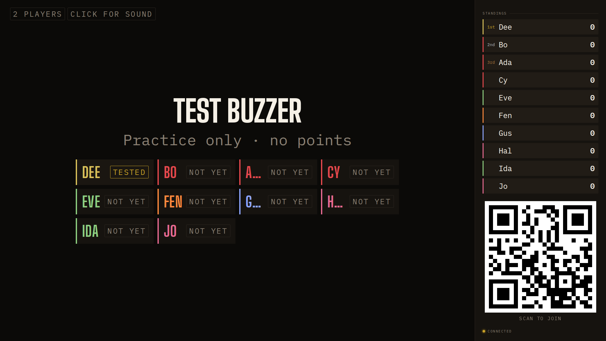
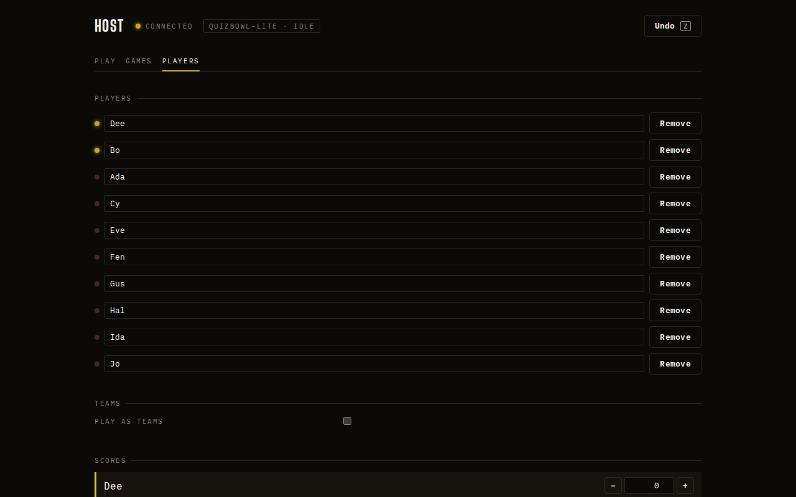

## Opportunity
The board's players chip counts connected phones; its standings list every
player ever joined, with no difference between the two.

Measured at 1920×1080: "2 PLAYERS" beside ten identical standings rows; in
the lobby the host desk says "0 of 2 tested" while the wall shows ten "Not
yet" tiles, eight of them for phones that are not there. Only the host's
Players tab draws a lamp per player. A party host who sees ten names on the
TV and two lit on the laptop has to work out which is wrong. Both views are
built from `state.players`, which carries `connected` for every role.

## Proposal
One rule in CSS and two components: a disconnected player's row is dimmed
(`--dim` text, 0.5 opacity on the identity bar) with a small "away" chip at
`--t-chip-board` × 0.8 on the board standings, the lobby roster and the
phone dial; the lobby roster sorts connected first. The players chip
reads "2 OF 10 PLAYERS" when the two numbers differ. No ordering change in
the standings: away players keep their rank.
In: the chip text, the dim rule, the away chip, the lobby sort. Out:
removing players, reconnection logic, the host tab.

Judge: sonnet, because the states are already in the view and the rule is
one class.

## What you'll see
Ten rows, two bright, eight dim with "away"; the chip says "2 OF 10
PLAYERS"; the lobby wall shows the two phones that are here first.

## Verification
`npm run build`, `npm test` (a `viewFor` case that `connected` reaches
phones and the board stays as it is). Join three probe players, let the
probe exit, and confirm all three surfaces dim them within a second.

## Risks and the alternative considered
A phone that drops for a second during a question would flicker; apply the
dim only after the hub's existing disconnect grace, if any, or a 2s CSS
transition delay. Alternative: hide away players entirely; rejected because
their score is still in the race.

## Needs from Rick
