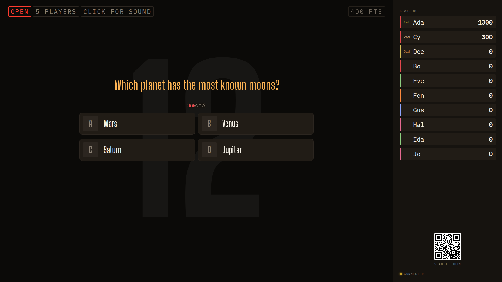

## Opportunity
Sketch's guess feed is drawn on top of the drawing, and its clock is a
48px number in a corner.

Measured at 1920×1080: `.sketch-chat` is positioned at
`left: calc(100% - var(--chat-w) / 2)` (`client/style.css:2841`), so half the
column sits over the canvas's right edge; by the fifth guess the chips cover
the bottom-right sixth of the picture. The guessers in the room are guessing
from that picture. The countdown "36" is `--t-xl` top-right, while the choice
question puts its seconds "huge and faded behind the whole wall"
(`.board__countdown`, design guide §7). Two clocks, two conventions, on the
same TV in the same night.

## Proposal
Give the feed its own column: the sketch wall becomes canvas plus a
`clamp(14rem, 18vw, 22rem)` feed column to its right, inside the wall, with
the canvas sized to the remaining width; the chips stack from the bottom as
now. Replace the corner clock with `.board__countdown` behind the canvas,
the same element the choice question uses, at the same opacity, and drop
the "36" in the status row. The word blanks stay above the canvas.
In: the layout, the clock. Out: chip styling, the phone, the reveal stamp.

Judge: opus, because the layout and the clock element are pinned and the
work is moving two elements.

## What you'll see
A clean picture with guesses beside it, not on it, and the seconds left
looming behind the drawing the way they loom behind a choice question.

## Verification
`npm run build`. `npm run sim-sketch -- 300` on a disposable room at
1920×1080 and 1280×720: twenty guesses never touch the canvas; the countdown
is legible through the drawing at 1280.

## Risks and the alternative considered
A faded number behind a busy drawing could be hard to read at the last ten
seconds; the choice question already solves this with its opacity ramp, and
proposal 032 would carry the clock in its frame if both land. Alternative:
shrink the chips; rejected because the room reads them.

## Needs from Rick
