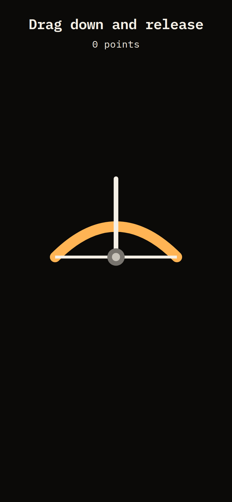
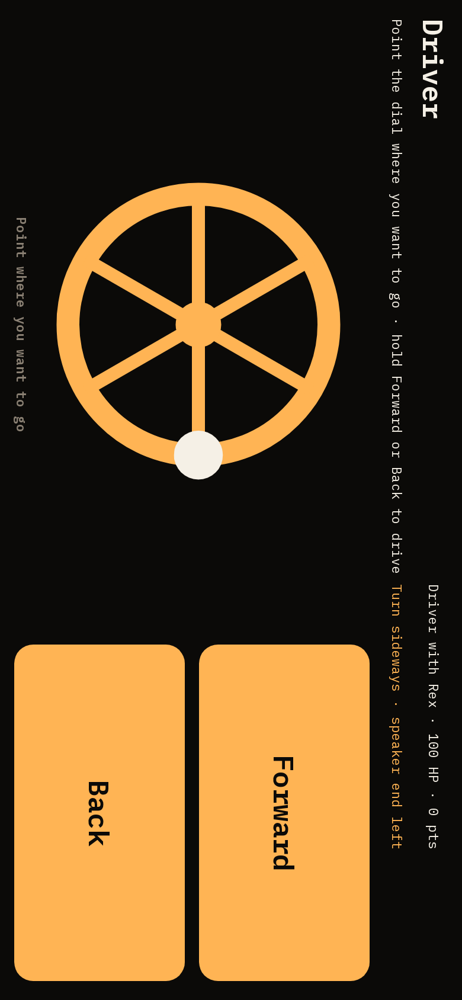
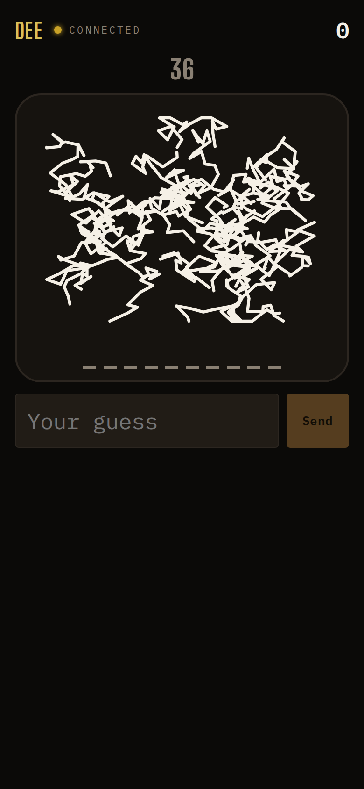

## Opportunity
The design guide §7 says of the phone: "The buzzer fills everything below a
single status bar. The player's name is rendered in their identity colour,
so you can tell whose phone you picked up." Bow and Tank throw the bar away.

Measured at 390×844: the Bow phone is "Drag down and release · 0 points" and
a bow, no name, no colour, no connection lamp, no score; Tank is sideways
with "Driver" and prints "Point where you want to go" twice (once in the
header line, once on the left edge). Sketch keeps the bar with name, lamp and
score; Poker has its own felt header with the name. Four minigames, three
conventions. At a party phones get put down and picked up; the bar is how
you know it is yours, and the lamp is how you know it is still connected.

## Proposal
`Player.tsx` renders the status bar above every minigame player view, as it
does for the quiz and Sketch; the Bow and Tank views give up their own title
line for it, so the instruction becomes the sub-line under the bar. Tank's
sideways layout rotates the bar with it (it already rotates the rest through
`useSideways`), and its duplicate instruction goes. Poker keeps its felt but
gets the same lamp beside the name.
In: the bar on four views, two deleted lines. Out: the controls, the
sideways compensation, Poker's layout.

Judge: sonnet, because the bar exists and the change is where it is
rendered.

## What you'll see
Every phone, all night, starts with "DEE · connected · 0" in Dee's colour;
below it the bow, the tank dial, the sketch canvas or the felt.

## Verification
`npm run build`. `npm run sim-bow -- 1 20` and `sim-tank -- 1 30` with a real
phone joined; the bar is there and rotates with Tank. `npm run review` phone
scenarios for each minigame.

## Risks and the alternative considered
Tank's sideways view is height-tight at 390×844 rotated; the bar costs about
60px of the long axis, which the buttons can give. Alternative: a name only,
no lamp; rejected because connection is what the guide puts in the bar.

## Needs from Rick
