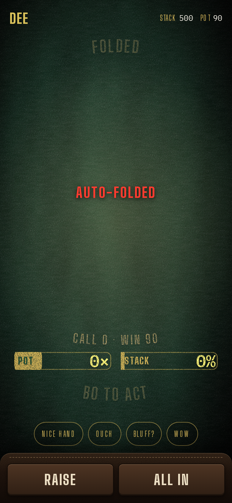

## Opportunity
A folded Poker phone keeps its live controls.

Measured at 390×844 after the shot clock auto-folded Dee: a "FOLDED" print
at the top, "AUTO-FOLDED" in tally mid-felt, then "CALL 0 · WIN 90", a pot
meter at 0× and a stack meter at 0%, "BO TO ACT", the four reactions, and
Raise and All in at full strength at the bottom. Dee cannot raise; the
buttons say she can. The design guide §8: "Never show a disabled control
with no reason." It also never says what happens next or when.

## Proposal
A folded hand (by flick or by clock) swaps the action strip and the
call/win line for one sub-line in the felt's own type: "Folded · next hand
after this one" (or "Folded by the clock · …" for an auto-fold), keeps the
reactions row, and shows the pot and the street's cards as the board shows
them, so a folded player still follows the hand. The meters stay hidden
until the next deal. A busted player gets "Out · you finished 5th" the same
way.
In: the folded and busted states of the phone. Out: the fold gesture, the
clock, the board.

Judge: opus, because the states and strings are pinned and the work is one
component's branches.

## What you'll see
Fold, and the phone says so and why, shows the pot growing without you, and
offers only reactions until the cards come round again.

## Verification
`npm run build`, `npm test`. `npm run sim-poker -- solo` with a phone
joined: fold by flick and by clock; both read correctly and no dead button
shows.

## Shown
- Builds: `npm run build` -> `✓ built in 758ms`
- Fold by flick says so and shows no dead button, on a headless 390×844 phone joined to `npm run sim-poker -- solo 1500` on a disposable room: `cache/fold/run.sh Dee flick solo 1500` -> `flick {"visibility":"hidden","cls":"poker-rail__row is-off"}  | Pot 100 | Folded⏎next hand after this one | Bet | All in` (Bet and All in are in the DOM, faded, hidden and `aria-hidden`)
- Fold by the clock says why, on a phone joined to the six-bot `npm run sim-poker -- 400` (heads-up, a fold ends the hand at once, so the clock fold was run at a full table): `cache/fold/run.sh Dee clock 400` -> `clock {"visibility":"hidden","cls":"poker-rail__row is-off"}  | face-down card | face-down card | face-down card | Pot 150 | Folded by the clock⏎next hand after this one | Raise | All in`
- Shows the pot growing without you and the street's cards as the board does (five fixed slots, the board's tilt, each new card face down until the board turns it): same run -> `clock-up {"visibility":"hidden",…}  | 4 of spades | 7 of diamonds | 3 of clubs | 4 of diamonds | 4 of hearts | Pot 1,530 | Folded by the clock⏎next hand after this one`
- Only reactions until the cards come round again: `cache/fold/run.sh Dee flick solo 1500` -> next hand `flick-later {"visibility":"visible","cls":"poker-rail__row "} Flick here to fold | face-down card | face-down card | Call 10 · win 40 | …`
- Busted gets "Out · you finished 5th" the same way: `cache/fold/run.sh Zed shove 400` -> `busted {"visibility":"hidden","cls":"poker-rail__row is-off"}  | Out · you finished 5th | Raise | All in`
- Easy to miss: the 300ms fade keeps Raise's place, so a thumb already moving lands on nothing rather than on a reaction: `client/style.css` `.poker-rail__row.is-off` (opacity over 300ms, then `visibility: hidden`, no layout change); the reactions row sits at the same y in the folded and in-hand screenshots.
- Not shown: the fade's 300ms on screen: the screenshot's own latency hides it, so it rests on the CSS rule; and how it feels on a real phone in the hand.

## Risks and the alternative considered
Hiding Raise removes a target a player might be about to tap when the clock
fires; a 300ms fade avoids the mis-tap landing on a reaction. Alternative:
grey the buttons; rejected because grey without a reason is the thing the
guide forbids.

## Needs from Rick
