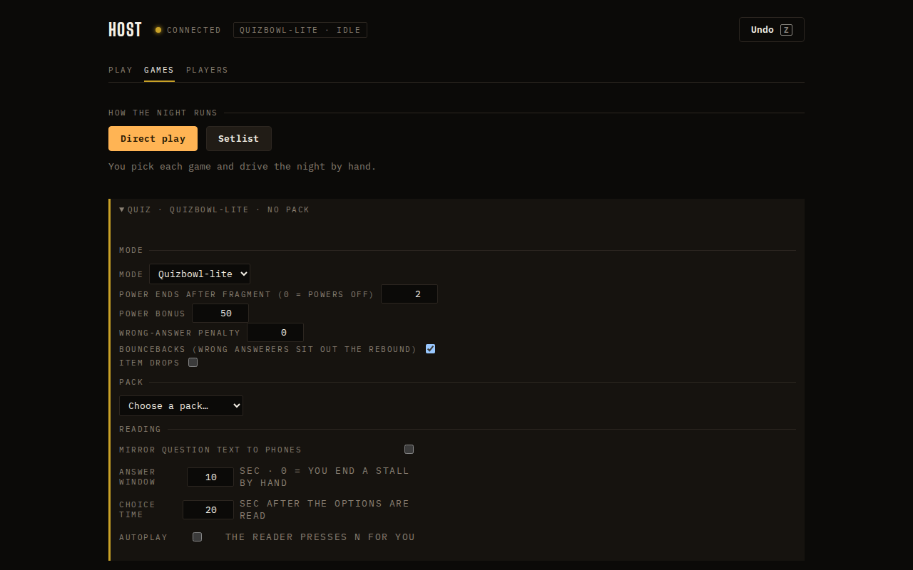
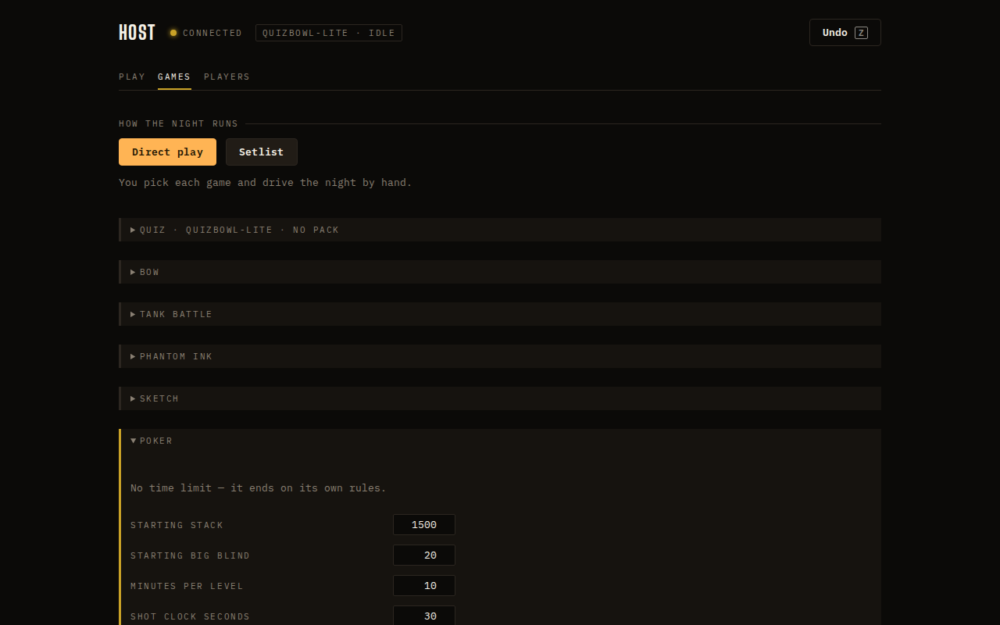

## Opportunity
The quiz fold on the Games tab is where a host sets up the night, and it is
eleven controls labelled in uppercase mono sentences.

Measured at 1280×800: "POWER ENDS AFTER FRAGMENT (0 = POWERS OFF)",
"BOUNCEBACKS (WRONG ANSWERERS SIT OUT THE REBOUND)", "SEC · 0 = YOU END A
STALL BY HAND" are labels at `--t-xs` (11px) uppercase tracked mono, the
eyebrow style. The design guide §8: "Sentence case everywhere except
eyebrows, chips, and key hints, which are uppercase because they are labels
rather than sentences." These are sentences. The fold's three sections
(Mode, Pack, Reading) share one left edge with the labels so nothing groups,
and the checkbox controls sit at four different x positions. The Poker fold
has the same rule applied differently: labels in uppercase, inputs aligned
right at 500px.

## Proposal
One form grammar for every fold, in `client/style.css` and the three setup
components: the eyebrow stays uppercase for the section (Mode, Pack,
Reading, Poker); each control is a `.field` row with a sentence-case label
at `--t-sm` chalk on the left, the control at a fixed column, and the
explanation ("0 turns powers off") as a dim `--t-xs` line under the label,
not inside it. Checkboxes become the existing toggle style aligned to the
same column. Numbers use the `.stepper`. The quiz fold's three sections get
`--s5` between them.
In: the grammar, the labels rewritten, the Poker and other minigame folds.
Out: new options, the setlist builder, the Players tab.

Judge: fable, because the column rhythm and the rewritten sentences need an
eye, not a rule.

## What you'll see
"Power ends after fragment  [2]  0 turns powers off", "Bouncebacks  [on]
Wrong answerers sit out the rebound", every control in one column, every
reason under its label, the same in Poker's fold.

## Verification
`npm run build`. Re-shoot the Games tab at 1280×800 with each fold open and
check every label is sentence case and every control sits on the same x.
`npm test` is unaffected.

## Shown
- Every label sentence case, chalk, `--t-sm`: `NO_OPEN=1 node cache/044/shoot.ts` (a Playwright pass over every fold at 1280×800) -> `x=435 none 13px rgb(245, 240, 230) | Power ends after fragment | 0 turns powers off`, and the same `none 13px rgb(245, 240, 230)` on all 28 fields.
- Every control on one x, in every fold: the same run -> `x=435` on every field line under Quiz, Bow, Tank battle, Sketch, Poker and Tug of war.
- The reason under its label, not inside it: `assets/044-after-quiz.png` ("Power ends after fragment [− 2 +]" with "0 turns powers off" beneath; "Bouncebacks [on]" with "Wrong answerers sit out the rebound" beneath).
- The same in Poker's fold: `assets/044-after-poker.png`.
- `--s5` between the quiz fold's three sections: the same run -> `## Quiz · Quizbowl-lite · game-night.txt sections top=-227,152,241 bottom=128,217,788` (24px between each section's bottom and the next top).
- `npm run build` -> `✓ built in 829ms`.
- `npm test` -> 879 pass, 0 fail across the five locations.
- `npm run test:review` (the layout fit check, run on port 4175 from `cache/044/playwright.config.ts` because another build held 4174) -> `307 passed`, `1 failed`: `answering-reactions board fits` (`span.timeline__name × span.board__pill`), which fails identically on `main` at ab7aa52 with this branch's files absent, so it is the reactions pill's, not this change's.
- Easy to miss: the `--s5` the spec asks for was already written on `.host__manage[open]`, but Chromium wraps a details' children in `::details-content` so the gap never reached the sections; `.host__manage::details-content { display: grid; gap: var(--s5) }` is what the measurement above shows.
- Not shown: "the existing toggle style": no switch existed in `client/style.css`, so `.toggle` (a checkbox drawn as a short rail with a brass knob) was added and the guide's §5 documents it.

## Risks and the alternative considered
Longer sentence-case labels wrap at 1280; the two-line explanation slot
absorbs that. Alternative: shorten the labels and keep uppercase; rejected
because the guide's rule is about what a sentence is, not how long.

## Needs from Rick
- nothing: the Games tab reads this way the next time the host page loads a build.
