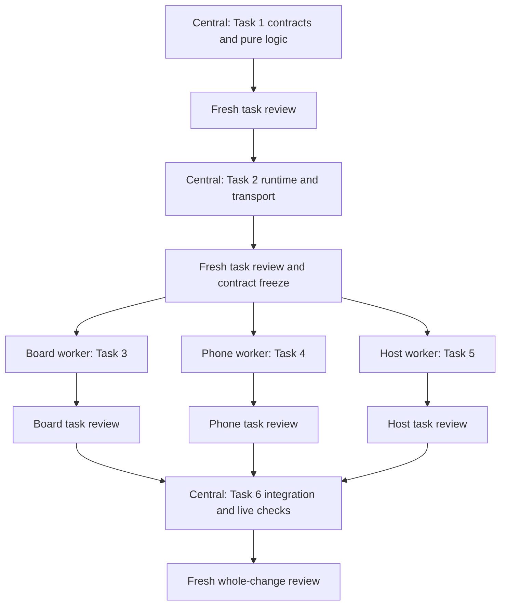

# Arrival Implementation Plan

> **For agentic workers:** REQUIRED SUB-SKILL: Use superpowers:subagent-driven-development or superpowers:executing-plans to implement this plan task-by-task. Steps use checkbox (`- [ ]`) syntax for tracking.

**Goal:** Let the host open a non-scoring playable lobby and introduce the first block of a fresh setlist before ordinary gameplay begins.

**Architecture:** A public optional arrival discriminant selects shared semantic moments. Practice uses typed replay-free receipts and browser-local pulses; first-block introductions use scoped host dismissal and explicit snapshot semantics. The central coordinator settles and implements shared contracts before board, phone, and host leaf components fan out into disjoint files.

**Tech Stack:** Node's native TypeScript, Preact, WebSocket, `node:test`, existing review/motion workbenches.

**Spec:** `docs/superpowers/specs/2026-10-05-arrival-design.md`

**Roadmap:** `docs/superpowers/specs/2026-10-05-game-night-roadmap.md`

**Status:** Proposed plan for review; no tasks executed. The user selected coordinator-led, dependency-aware subagent fanout. Review the planning artifacts before implementation; do not ask them to select an execution method again.

## Global Constraints

- Trusted LAN; no authentication, remote service, or analytics dependency.
- Node is pinned by `mise.toml`; native TypeScript uses `.ts` relative imports, no enums or constructor parameter properties.
- Preact surfaces retain one socket through `useSocket`; browser effects and timing stay in the client.
- `Hub.dispatch` owns host commits and applied/unchanged/refused/failed outcomes; refused or unchanged actions change no history, timers, or broadcast state.
- `shared/legality.ts` owns host-action legality; `shared/wall.ts` owns semantic display priority and remains pure.
- Preserve phone redaction, question/attempt identities, existing scoring, and minigame ownership.
- Use local assets, design tokens, and existing `fx-*`/interest-kit effects; no new dependencies, keyframes, or runtime asset fetches.
- Lobby pulse lifetime is 600 ms, measured locally from receipt; timing measurements remain still.
- Practice never changes scores, round data, items, effects, setlist progress, judge state, or undo history.
- Opening or closing the lobby creates no undo step; introduction dismissal does.
- Arrival is omitted from durable snapshots; introduction participates in undo, lobby does not.
- Pulse ticks are 50 ms while pulses remain active; frozen previews do not tick.
- No Bow/Tank visual polish, minigame practice, later-block intros, new recipes, predictions, milestones, or recap/export in this slice.

## Review Focus

1. A stale practice press or Continue from another arrival must have no effect (Tasks 1–2).
2. A fresh setlist over an idle retained choice/verdict must show only the introduction, without leaking old content to phones (Task 2).
3. Read requested during an introduction, or an introduction created during preparation/card dwell, must not arm later or deadlock the reader (Task 2).
4. Kept-cursor/no-op edits, empty undo, applied undo, and legacy restart must preserve the specified identities and ownership (Task 2).
5. Simultaneous/repeated tests, reconnect, rename, or player removal must preserve tested marks correctly and never replay or erase the wrong pulse (Tasks 1–2, then live checks in Task 6).

## File ownership

| Owner | Files | Responsibility |
| --- | --- | --- |
| Central, Task 1 | `shared/protocol.ts`, `shared/arrival.ts` (new), `shared/arrival.test.ts` (new), `client/arrival-feedback.ts` (new), `client/arrival-feedback.test.ts` (new) | Types, fixed copy, pure eligibility and pulse reducers |
| Central, Task 2 | `shared/legality.ts`, `shared/wall.ts`, `server/state.ts`, `server/hub.ts`, `server/reader.ts`, `server/snapshot.ts`, `client/useSocket.ts`, `client/usePractice.ts` (new), `client/ui.ts`, exhaustive host moment notes in `client/Host.tsx`; corresponding existing tests | Runtime/transport/projection foundation, cancellation, undo/disk, refusal copy |
| Board worker, Task 3 | `client/ArrivalBoard.tsx`, `client/arrival-board.css` (both new) | Board leaf presentation only |
| Phone worker, Task 4 | `client/ArrivalPhone.tsx`, `client/arrival-phone.css` (both new) | Phone leaf and practice gesture only |
| Host worker, Task 5 | `client/ArrivalHost.tsx`, `client/arrival-host.css` (both new) | Host arrival controls only |
| Central, Task 6 | `client/Board.tsx`, `client/Player.tsx`, `client/Host.tsx`, `tools/review/fixtures.ts`, `README.md`, `ARCHTECTURE.md`, `docs/design.md`, `docs/manual-checklist.md` | Mount points, existing audio/haptics, frozen scenarios, documentation, full verification |

Preserve existing shared styles; each leaf imports its own scoped stylesheet.
No worker edits shared mount points, runtime files, another worker's files,
snapshots, or the dependency lockfile.

## Execution graph and review gates



Start with the existing linked worktree: verify isolation through the
using-git-worktrees skill, do not create a nested checkout. Create this plan's
SDD workspace/ledger using the skill's supplied helper. Record task ids,
dependency/interface checks, commits, review findings, and rulings there.

At most three worker/reviewer slots run alongside the coordinator. A finished
worker frees a slot for its fresh reviewer while other independent workers
continue. Give isolated workers the relevant task, spec, common interfaces,
owned-file allowlist, and validation expectations. Do not copy the whole chat.

The coordinator alone stages and commits in the shared checkout. Fanout workers
return scoped diffs and reports, never concurrent git mutations. Central fixes
or interface changes stop the affected dependency path until reviewed. Resume
completed tasks from the ledger; do not redispatch them. Apply Superpowers' task
review and fix loop, plus a fresh whole-change review at the end.

---

### Task 1: Freeze types, content, and pure practice behavior

**Files:** Task 1 row in the ownership table.

**Interfaces produced:**

- `Arrival`, `PracticeReceipt`, `State.arrival?`, host actions and wire messages exactly as specified in the design.
- `shared/arrival.ts`: `PRACTICE_PULSE_MS = 600`, `IntroductionCopy`, `ArrivalPresentation`, `practiceAllowed(state: State, playerId: PlayerId, lobbyId: string): boolean`, `arrivalBlocksPlay(state: State): boolean`, `introductionFor(gameId: string): IntroductionCopy`, `arrivalPresentation(state: State): ArrivalPresentation | null`.
- `client/arrival-feedback.ts`: `PracticeFeedback = { lobbyId?: string; pulses: Record<PlayerId, { seq: number; receivedAt: number }> }`; `emptyPractice(lobbyId?: string): PracticeFeedback`; `recordPractice(feedback: PracticeFeedback, receipt: PracticeReceipt, lobbyId: string | undefined, receivedAt: number): PracticeFeedback`; `prunePractice(feedback: PracticeFeedback, lobbyId: string | undefined, playerIds: readonly PlayerId[]): PracticeFeedback`; `activePracticePlayers(feedback: PracticeFeedback, lobbyId: string | undefined, now: number): PlayerId[]`.

- [ ] **Step 1: Add failing pure tests.** Test practice acceptance for current connected roster identity/lobby; reject wrong scope, missing/disconnected player, reading, and minigame. Test lobby versus introduction play gating. Assert each initial copy row and generic fallback from the spec. Test pulses with injected times, including the exact boundary:

  ```ts
  const receipt = { lobbyId: 'lobby-a', seq: 1, playerId: 'ada' }
  const tested = recordPractice(emptyPractice('lobby-a'), receipt, 'lobby-a', 1000)
  assert.deepEqual(activePracticePlayers(tested, 'lobby-a', 1599), ['ada'])
  assert.deepEqual(activePracticePlayers(tested, 'lobby-a', 1600), [])
  assert.deepEqual(activePracticePlayers(tested, 'lobby-b', 1000), [])
  ```

  Also assert two players remain active together; seq 2 at 1400 refreshes Ada
  through 1999 without changing Bo's time; duplicate/older seq leaves the
  feedback unchanged; pruning removes a departed player; new/absent lobby
  clears feedback. Test renamed identity by resolving ids against the current
  roster, rather than storing names in the feedback contract. Assert
  `arrivalPresentation` yields the same copy from full and redacted state and
  never includes pack text, answers, or reader progress.

- [ ] **Step 2: Run the tests and confirm the missing imports/functions fail.**
  `node --test shared/arrival.test.ts client/arrival-feedback.test.ts`
- [ ] **Step 3: Implement the listed types and helpers.** Copy exact text from the spec; use a static registry with no game rules. Bound feedback to one latest receipt per roster identity; compare sequence per player and reject a receipt unless its lobby is current.
- [ ] **Step 4: Re-run the focused tests.** Expected: all pass. Do not claim whole-project typecheck yet: new host-action/refusal handling is completed in Task 2.
- [ ] **Step 5: Review and commit the contract task.** Coordinator stages only Task 1 files; commit `feat: define arrival and practice contracts`. Task 2 consumes these exact interfaces.

### Task 2: Integrate lifecycle, transport, shared moments, and snapshots

**Files:** Task 2 row in the ownership table. Add tests to `server/hub.test.ts`, `server/state.test.ts`, `server/setlist.integration.test.ts`, `server/reader.joined.test.ts`, `server/snapshot.test.ts`, `shared/legality.test.ts`, and `shared/wall.test.ts` as appropriate to existing rigs.

**Consumes:** All Task 1 interfaces; existing `Hub.dispatch`, `Hub.viewFor`, `gameSnapshot`, `persistedSnapshot`, `Reader.start`, and `momentOf`.

**Produces:**

- `refuses` handles new actions plus `arrival-changed`, `introduction-active`, `reading-active`, and `duel-active` refusal codes; lobby entry uses existing `not-idle`/`minigame-active` codes for those conditions, with copy in `client/ui.ts`.
- `Moment` gains `arrival:lobby` and `arrival:introduction`. `Wall.arrival` is `ArrivalPresentation | null`. Other occupant/ancillary object lanes are null during arrival; `timeline` is false and `value` is null. `phoneOf` and exhaustive Host moment notes handle these moments. Phones consume `arrivalPresentation`, never the full board-only `wallOf` projection.
- `SocketFixture.practice?: PracticeFeedback`; `useSocket` returns `practice: PracticeFeedback` alongside its existing fields. Receipt times use `performance.now()` outside fixtures; state messages prune/scope feedback, socket loss clears it. No receipt is sent on reconnect.
- `client/usePractice.ts`: `usePracticeTime(feedback: PracticeFeedback, lobbyId?: string, frozenNow?: number): number`. Returns monotonic client time; ticks at 50 ms only while pulses are active; uses `frozenNow` without effects for review fixtures.
- Hub practice relay through the new message discriminant; private seq reset only on a new lobby, no `changed()` for practice or lobby entry/exit.

- [ ] **Step 1: Add failing lifecycle and ownership tests using current direct-Conn/fake-speech rigs.** Include these checkable expectations:
  - `openLobby` with zero players applies; a second call is unchanged with the same id and no history/publication. Reading, active round, duel, minigame, or intro refuses entry.
  - A valid test sends an own receipt, marks tested once, and preserves `round`, scores, inventories, effects, setlist and existing undo behavior. Spy `onChange` remains at zero for opening, testing, and closing lobby. Repeated presses emit new seq without adding another tested id.
  - Invalid connection role, nonmember connection, removed identity, mismatched lobby, and outside-lobby practice emit nothing and leave state untouched.
  - Applied Arm or accepted reader-active publication exits lobby; refused/no-op gameplay does not. Empty Undo keeps lobby; applied Undo cancels it. A new lobby id rejects delayed old receipts.
  - Fresh `setSetlist` and saved-setlist loading create intro at block zero. Kept-position edits preserve pending id; unchanged rebuild returns unchanged. Jump/Next/reset/clear remove intro; later advances do not create it.
  - Matching intro close changes only `arrival`; stale/absent close is refused, with no history/timer/broadcast changes. Undo restores the intro with a different id.
  - Arm and prepareMinigame refuse during intro. Hidden player `duel*` acts do not alter the initialized pool. Continue does not arm, consume a question, or prepare a match.
  - Read during intro never activates a reader or renders/plays clips. Dismiss it and assert the reader is still stopped. Use fake speech/card dwell to create intro during preparation and assert the old loop settles without arming. Exercise refused-arm handling without real sleeps/native speech.
  - For old choice/verdict data, both full and redacted state select `arrival:introduction`; the board's `wallOf` exposes no previous transcript, answer, choices, award, hero, or timeline. The phone's `arrivalPresentation` carries only the shared introduction copy.
  - Undo snapshots omit lobby and retain intro; restored intro id is fresh. Disk projection omits both. Loading crafted versioned and legacy files explicitly removes `arrival` without recreating an intro from `at/done`.
- [ ] **Step 2: Run the affected tests and establish the missing-behavior failures.** Use the exact file paths above, including fake-speech reader coverage.
- [ ] **Step 3: Implement the state/Hub/snapshot/Reader foundation.** Lobby host actions take the direct runtime branch. Intro creation and dismissal use normal commits. Stop Reader on applied intro creation with intermediate publications suppressed. Return from Read during intro; handle refused arm before waiting. Keep existing setlist setup/duel timing and minigame handoffs.
- [ ] **Step 4: Implement shared moments and socket feedback using Task 1 helpers.** Keep semantic priority in `shared/wall.ts`, client expiry in the hook, and fixture times injected. Update exhaustive unions and refusal copy now so typecheck can pass.
- [ ] **Step 5: Run focused tests, `npm test`, and `npm run typecheck`.** Expected: all pass; no browser/network/native speech required for the new logic. Review and commit `feat: integrate arrival lifecycle and practice transport`. Freeze these interfaces before fanout.

### Task 3: Board arrival leaf — fanout lane A

**Files:** Create `client/ArrivalBoard.tsx`, `client/arrival-board.css`.

**Consumes:** Task 2 `Wall.arrival`, Task 1 feedback/active-player helpers, current roster, `colorForPlayer`, design tokens and existing effects.

**Produces:** `ArrivalBoard({ state, arrival, feedback, pulseNow }: { state: State; arrival: ArrivalPresentation; feedback: PracticeFeedback; pulseNow: number })`.

- [ ] **Step 1: Implement the lobby roster/tested marks and concurrent name pulses.** Render current names/colors, not names cached in receipts. Use one existing effect for each accepted pulse; no game measurements or new keyframes.
- [ ] **Step 2: Implement the introduction's title, goal, and First block label.** Render the projection supplied by central; do not select moment priority here or fetch assets.
- [ ] **Step 3: Add scoped token-based styling and review targets.** Fit long names and roster sizes into the existing board layout. Retain QR ownership in the parent; do not create another QR implementation.
- [ ] **Step 4: Run `npm run typecheck` and self-review against the spec.** Skip JSX/glue tests. Report owned files, any necessary parent mount, and layout cases for central's review fixtures.
- [ ] **Step 5: Return for a fresh task review.** Coordinator commits only reviewed owned files as `feat: add board arrival presentation`; visual fit is checked after Task 6 mounts it.

### Task 4: Phone arrival leaf — fanout lane B

**Files:** Create `client/ArrivalPhone.tsx`, `client/arrival-phone.css`.

**Consumes:** Task 1/2 interfaces; parent-provided identity/socket feedback and practice callback.

**Produces:** `ArrivalPhone({ state, arrival, playerId, connected, feedback, pulseNow, onPractice }: { state: State; arrival: ArrivalPresentation; playerId: PlayerId | null; connected: boolean; feedback: PracticeFeedback; pulseNow: number; onPractice: () => void })`.

- [ ] **Step 1: Implement the native button gesture and confirmed-feedback states.** Test buzzer invokes `onPractice` once; Buzzer tested requires an own receipt. Show Practice only · no points, persistent tested status, and an explained disconnected state. Disable testing without a connected joined identity.
- [ ] **Step 2: Implement the introduction instruction and Waiting for the host.** Keep the identity bar in the parent. No hidden game controls, new socket, microphone request, or concrete mode branches.
- [ ] **Step 3: Add scoped styling using the existing one-hand phone layout and effects.** Support narrow screens, long instructions and reduced motion; no scrolling/overlapping controls.
- [ ] **Step 4: Run `npm run typecheck` and self-review.** Skip JSX/glue tests. Report callback expectations and layout cases; root supplies the existing sound/haptic action in Task 6.
- [ ] **Step 5: Return for a fresh task review.** Coordinator commits reviewed owned files as `feat: add phone practice and introduction presentation`.

### Task 5: Host arrival controls — fanout lane C

**Files:** Create `client/ArrivalHost.tsx`, `client/arrival-host.css`.

**Consumes:** State, `HostAction`, `refuses`, refusal copy, shared copy projection.

**Produces:** `ArrivalHost({ state, act }: { state: State; act: (action: HostAction) => void })`.

- [ ] **Step 1: Implement Open lobby and its explicit disabled reason using shared legality.** Zero players must remain allowed. Do not implement a second rules ladder or a new global keyboard shortcut.
- [ ] **Step 2: Implement tested count/Close lobby and introduction/Continue.** Closing passes the current id. Continue is dismissal only; no arm/read/open-match calls and no unanimous-ready requirement.
- [ ] **Step 3: Add scoped styling consistent with the Play desk.** Roster and game setup remain in their existing tabs; no Bow/Tank settings or visual changes.
- [ ] **Step 4: Run `npm run typecheck` and self-review.** Skip JSX/glue tests. Report parent mount and any existing control that must be disabled/explained during intro.
- [ ] **Step 5: Return for a fresh task review.** Coordinator commits reviewed owned files as `feat: add host arrival controls`.

### Task 6: Central integration, review scenarios, and complete verification

**Files:** Task 6 row in the ownership table; any correction to prior owned files is explicitly coordinated after fanout stops.

**Consumes:** Reviewed Tasks 1–5 interfaces and leaves. **Produces:** The complete operable first slice and updated guides.

- [ ] **Step 1: Mount leaves through shared moment/projection selection.** Board and phone own their socket once, call the pulse-time hook with fixture time when supplied, and cover old content during arrival. Keep existing QR, identity bars, and normal gameplay components in their owning parents.
- [ ] **Step 2: Wire the phone callback to existing press audio/haptics and typed practice send.** Use current lobby id; prevent disconnected/local-only success claims. Disable/explain Read during intro using `arrivalBlocksPlay`; Arm/Open match follow `refuses`. Preserve normal control behavior outside arrival.
- [ ] **Step 3: Add real-component frozen scenarios.** Cover lobby with zero/many/long-name players, untested phone, own accepted pulse, simultaneous player pulses, tested reconnect without pulse, disconnected phone, and intro for quiz/choice-capable instructions and a minigame first block. Include an old retained choice/verdict underneath intro to expose masking errors. No simulated elapsed-time assertions from frozen screens.
- [ ] **Step 4: Update the four guides.** Explain explicit Open lobby and Continue, no points/readiness gate, first-only intro, restart omission, undo behavior, receipt/runtime ownership, and the real-device checklist. Do not describe deferred projects as implemented.
- [ ] **Step 5: Run `npm test`, `npm run typecheck`, `npm run build`, and `npm run test:review`.** Expected: all exit zero. Inspect board/phone scenarios with the repository review-workbench skill and T3 preview tools; investigate any fit regression. Run `npm run motion` if feedback motion or sound changed.
- [ ] **Step 6: Validate live behavior in a disposable room.** Use fake speech/temporary persistence for automated integration. Manually test one iPhone and one Android: join/audio unlock, concurrent test presses visible on board, own server confirmation, disconnect/reconnect without replay, rename/removal, stale control safety, first Arm/Read, first-block intro over retained results, undo, and a minigame first block dismissed before Open/Start. Actual hardware checks require the user's device participation; report anything not exercised without claiming a pass.
- [ ] **Step 7: Fresh whole-change review, fixes, and final report.** Review contracts, source diff, test evidence, persistence/redaction, and excluded scope. Coordinator commits integration as `feat: connect the game-night arrival experience`. Use the finishing skill after checks/review; no push, merge, deployment, or PR is implied by this planning request.

## Plan self-review

- Each spec behavior is assigned to Task 1 pure logic, Task 2 lifecycle, a named leaf task, or Task 6 integrated/manual validation.
- All five Review Focus cases have explicit tests/checks above; UI rendering receives frozen/live inspection, not implementation-mirroring tests.
- Tasks 3–5 share interfaces, not editable files. Their only dependency is reviewed Task 2; Task 6 waits for all three reviews.
- All cross-cutting edits and git operations have a single central owner. Tasks 1–2 are intentionally serialized; fanout does not weaken cancellation or snapshot review.
- Any newly discovered interface change is resolved and recorded centrally before dependent workers resume. Later projects remain separate specs/plans, not hidden additions to this slice.
